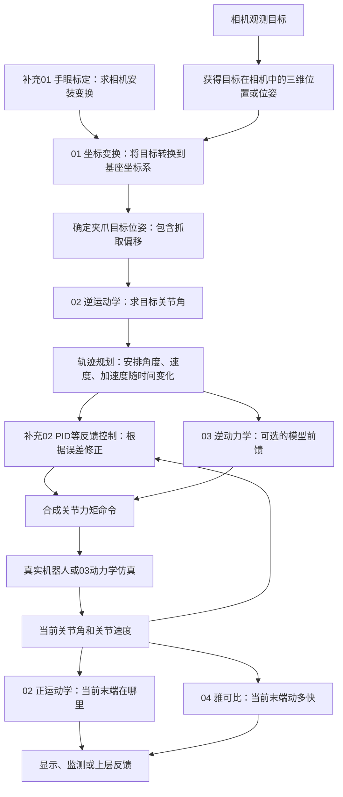
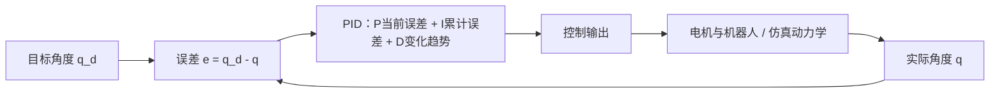
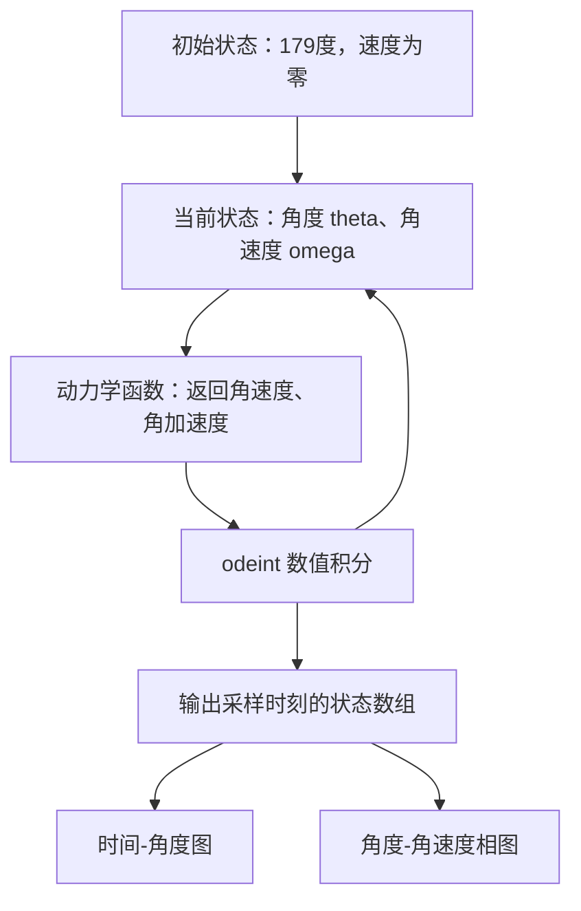
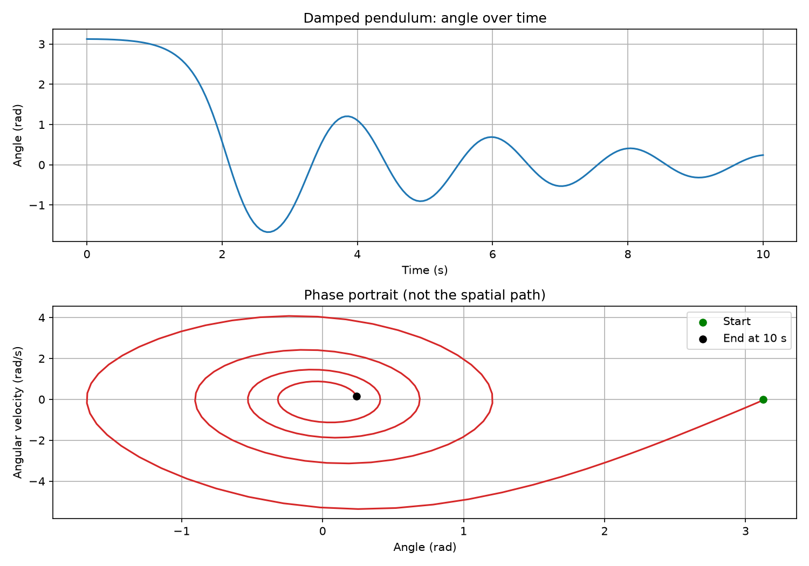

# 02 篇章完整串联图解：从看见目标到机器人运动

整理日期：2026-10-29。

对应目录：`02-机器人基础和控制、手眼协调`，包含 01～05 和两个补充章节。本篇用于把已学知识串联起来，具体推导保留在各篇学习记录中。

## 1 先看全景：每一章在系统里负责什么

下面用“相机看见物体，机器人移动过去”的场景串联。它是一种采用关节力矩控制的典型组织方式，不意味着所有机器人都必须由用户实现每个模块。



视觉求三维位姿、抓取策略和轨迹规划在图中承担衔接作用，不是本章已经完整实现的功能。普通二维检测框也不能直接当成三维机器人目标。

| 章节 | 输入 | 输出 | 它解决的问题 |
| --- | --- | --- | --- |
| 01 空间描述与坐标变换 | 一个坐标系中的点、已知变换 | 另一个坐标系中的点 | 同一个东西换个参照系怎么描述？ |
| 02 运动学与 DH | 关节角、机器人几何参数 | 末端位姿 | 机器人现在在哪里、朝哪里？ |
| 补充01 手眼标定 | 多组机器人位姿与标定板观测 | 相机与机器人之间的固定变换 | 相机看到的位置如何与机器人对应？ |
| 03 动力学 | 状态、物理参数与力矩 | 加速度；反向计算时输出所需力矩 | 力和运动有什么关系？ |
| 补充02 PID | 目标、实际值、误差历史 | 控制输出 | 实际状态偏离目标，怎么纠正？ |
| 04 雅可比 | 当前姿态、关节速度或末端力 | 末端速度或对应关节力矩 | 关节侧与末端侧如何联系？ |
| 05 综合实战 | DH 参数、单摆模型和初始条件 | 末端矩阵、运动曲线 | 用计算验证前面的公式 |

## 2 所有公式开始之前：分清状态、速度、力

```text
关节侧                         末端侧

q：关节角度     ──正运动学──→  位姿：位置和朝向
点q：关节速度   ──雅可比────→  线速度和角速度
τ：关节力矩     ←─雅可比转置─  F：末端力和力矩
```

这些箭头表示数学对应关系，尤其最后一条不表示电流或信号一定按这个方向流动。

| 符号 | 含义 | 旋转关节模型中的常见单位 |
| --- | --- | --- |
| q | 关节角度 | rad |
| 点 q | 关节角速度 | rad/s |
| 两点 q | 关节角加速度 | rad/s² |
| p | 末端位置 | m，UR5 实战则使用 mm |
| R | 末端朝向的旋转矩阵 | 无量纲 |
| τ | 关节力矩 | N·m |
| F | 末端力与力矩组成的向量 | 力为 N，力矩为 N·m |

角度为零不代表速度为零，速度为零不代表加速度为零，合力矩为零也不代表当前速度为零。

例如单摆刚被松手时，速度可以为零，但重力力矩使加速度不为零，于是随后开始运动。

## 3 第一座桥：坐标变换把“相机看到的”变成“机器人能用的”

### 3.1 坐标变换没有把物体搬走

同一个目标，站在相机处和站在机器人基座处观察，会得到不同坐标。变换的是描述，不是物体本身。

本文统一约定：`ᴬT_B` 把 B 系坐标转换成 A 系坐标，也表示 B 系在 A 系中的位姿。

$$
{}^AT_B=\begin{bmatrix}{}^AR_B&{}^At_B\\0&1\end{bmatrix},\qquad
{}^Ap={}^AR_B\,{}^Bp+{}^At_B
$$

```text
B 系中的点坐标
    ↓ R：将坐标分量转换到 A 系的轴方向
    ↓ t：加上 B 系原点在 A 系中的位置
A 系中的同一个点坐标
```

例如 B 相对 A 绕 Z 转 90°，B 原点在 A 的 (2,1,0)，B 中的点为 (1,0,0)：

```text
B 的 X 方向在 A 中朝 +Y
所以 B 中的 (1,0,0) → A 方向分量 (0,1,0)
再加 B 原点位置 (2,1,0)
得到 A 中的点 (2,2,0)
```

### 3.2 手眼标定是在求这条链中未知的一段

定义 B 为基座、E 为末端、C 为相机、O 为目标物体。

眼在手上：

```text
目标 O ──相机观测 ᶜT_O──→ 相机 C
       ──手眼标定 ᴱT_C──→ 末端 E
       ──正运动学 ᴮT_E──→ 基座 B
```

$$
{}^BT_O={}^BT_E(q)\,{}^ET_C\,{}^CT_O
$$

从右往左作用：目标坐标先进入相机系，再进入末端系，最后进入基座系。

- `ᴱT_C`：安装刚性不变时是固定的，由标定求得。
- `ᴮT_E(q)`：随关节角改变，由正运动学计算。
- `ᶜT_O`：来自视觉观测。

眼在手外：

```text
目标 O ──相机观测 ᶜT_O──→ 相机 C ──固定安装变换 ᴮT_C──→ 基座 B
```

$$
{}^BT_O={}^BT_C\,{}^CT_O
$$

相机固定在外部时，通常需要求基座与相机之间的固定变换；不能继续假定末端与相机的关系固定。

### 3.3 AH = HB 为什么出现，旋转和平移怎么衔接

标定时利用多次运动与观测，以及“某一安装关系始终不变”的约束，可以整理成：

$$
AH=HB
$$

A、B 是按一致方向构造的已知相对运动，H 是未知固定变换。这里方程中的 B 是矩阵名称，不是上面代表基座的坐标系标签。

将齐次矩阵相乘后分别比较旋转和平移部分：

$$
R_A R_H=R_H R_B
$$

$$
R_A t_H+t_A=R_H t_B+t_H
$$

先按原文 Park 方法求旋转，再把已求得的旋转代入：

$$
(R_A-I)t_H=R_Ht_B-t_A
$$

多组数据堆叠后求平移的最小二乘解。运动需要有足够的方向变化，单一或退化运动不保证能唯一确定标定结果。

## 4 第二座桥：运动学把“关节角”变成“末端位姿”

### 4.1 DH 是建立变换链的规则

```text
几何结构 + 关节角
        ↓ 按标准 DH 规则建立每段变换
T_01、T_12、T_23……
        ↓ 按连接顺序相乘
T_06：末端相对于基座的位姿
```

标准 DH 单段变换：

$$
{}^{i-1}T_i=R_z(\theta_i)T_z(d_i)T_x(a_i)R_x(\alpha_i)
$$

UR5 的六段链：

$$
{}^0T_6={}^0T_1{}^1T_2{}^2T_3{}^3T_4{}^4T_5{}^5T_6
$$

局部轴方向会随着前面变换改变，所以不能把所有局部平移直接沿世界轴相加。负的 a 是有向坐标距离，不是实体连杆长度为负。

### 4.2 正运动学、逆运动学和轨迹规划各做一步

```text
正运动学：已知 q ───────→ 末端位姿
逆运动学：目标末端位姿 ─→ 一组可行的目标 q
轨迹规划：当前 q 到目标 q → 每个时刻的 q_d、点q_d、两点q_d
```

逆运动学可能有多个解或没有可行解，还要考虑关节范围等约束。求到终点角度，不等于已经安排了沿途怎么走。

## 5 第三座桥：雅可比连接关节速度与末端速度

对平面两连杆，用 s = [x,y,φ]ᵀ 表示末端位姿：

$$
s=f(q)\quad\xrightarrow{\text{对时间求导}}\quad\dot s=J(q)\dot q
$$

```text
姿态 q ─────────────→ 决定当前 J 的数值
                              ↓
关节角速度 点q ─────→ J × 点q ─────→ 末端速度 点s
```

两根杆各长 1 米且水平伸直：

```text
                                      ↑ 末端速度方向
肩 O────────────────肘 E──────────────P
           1 m                1 m

只转肩：P 绕 O，半径 2 m → Y 速度贡献为 2 点θ₁
只转肘：P 绕 E，半径 1 m → Y 速度贡献为 1 点θ₂
```

$$
\begin{bmatrix}\dot x\\\dot y\\\dot\phi\end{bmatrix}
=\begin{bmatrix}0&0\\2&1\\1&1\end{bmatrix}
\begin{bmatrix}0.1\\0.2\end{bmatrix}
=\begin{bmatrix}0\\0.4\\0.3\end{bmatrix}
$$

末端此刻沿 Y 的线速度为 0.4 m/s，朝向变化率为 0.3 rad/s。它们是不同物理量。

记住三个边界：

1. XY 是约定的运动平面，不是“静止时自动形成的平面”；水平放置时，图上向上可以是桌面远处，而非现实升高。
2. 只转肩时“肘关节不转”是相对角度不变，肘部仍会被肩部带着移动。
3. 点 x = 0 仅针对伸直瞬间。之后姿态改变，J 也改变，不能据此说末端一直没有 X 位移。

伸直时前两行的位置雅可比秩为 1，位置任务丢失一个瞬时速度方向；包含朝向的完整 3×2 矩阵仍可有秩 2。这两个结论不矛盾。

三维机器人通常用几何雅可比输出线速度 v 和角速度 ω。欧拉角的导数一般不能直接当作 ω；使用力矩映射时必须匹配相应速度定义。

## 6 第四座桥：为什么同一个 J 还能联系力矩

```text
速度关系：关节速度 ── J ──→ 末端速度
力的关系：关节力矩 ←─ Jᵀ ── 末端力与力矩
                   ↑
             两者满足功率配对
```

$$
F^T\dot s=F^TJ\dot q=(J^TF)^T\dot q
$$

与这份末端作用对应的关节广义力矩为：

$$
\tau_F=J^TF
$$

伸直例子中，末端向上的 5 N 对肩部力臂是 2 米、对肘部是 1 米，因此对应 10 N·m 和 5 N·m。不是把 5 N 平分给两个关节。

但 τ_F 不是机械臂所有运动情况下的完整电机力矩。惯性、重力、摩擦等还需要动力学处理。

符号也要分清：若 F_ext 为环境施加给机器人的外力，JᵀF_ext 是它产生的广义力矩；忽略重力等作用时，电机为静态平衡它要施加相反力矩。

## 7 第五座桥：动力学把力矩变成随时间变化的运动

采用环境对机器人施力的约定，简化动力学可写成：

$$
M(q)\ddot q+C(q,\dot q)\dot q+g(q)+\tau_{\mathrm{friction}}
=\tau_{\mathrm{motor}}+J^TF_{\mathrm{ext}}
$$

```text
当前 q、点q + 电机力矩 + 外部作用
                   ↓ 动力学
                 加速度
                   ↓ 时间积分
                 新速度
                   ↓ 时间积分
                 新角度
                   ↓ 正运动学
                 新的末端位姿
```

积分器实际会耦合处理状态更新，上图用于区分各物理量。

| 计算方向 | 已知 | 求什么 |
| --- | --- | --- |
| 正动力学 | 当前状态、施加力矩、外部作用 | 加速度，随后可积分预测运动 |
| 逆动力学 | 指定状态与加速度、外部作用 | 实现该运动需要的力矩 |

同样几何结构的轻、重机械臂，正运动学可以相同，但动力学参数不同，因此实现相同运动所需力矩通常不同。

## 8 第六座桥：PID 让实际运动靠近目标



$$
u=K_pe+K_i\int e\,dt+K_d\dot e
$$

| 项 | 看什么 | 常见作用与牵制 |
| --- | --- | --- |
| P | 当前误差 | 增强纠偏，但过强可能带来振荡或超调 |
| I | 过去累计的误差 | 消除持续偏差，但积累过多可能造成超调与饱和问题 |
| D | 误差变化趋势 | 常用于改善阻尼，但对噪声敏感 |

三项不是三个独立电机，而是相加形成控制输出。它们的合适大小取决于被控对象、单位和采样周期，不是固定配比。

PID 输出由接口决定：可能是力矩，也可能是速度指令等。只有在当前采用的力矩控制结构下，才能直接把 u 当作电机力矩或力矩修正。

一种结合方式：

$$
\tau_{\mathrm{motor}}=\tau_{\mathrm{前馈}}+\tau_{\mathrm{PID修正}}
$$

模型前馈估计需要多少力矩，PID 根据实际误差修正；它们不是互不相关的两条平行流程。

## 9 两项实战分别落在总图的哪里

### 9.1 UR5 实战：验证坐标变换与正运动学

脚本：[01_UR5正运动学.py](../实战练习代码/01_UR5正运动学.py)。

```text
输入六个关节角（度）
    ↓ 转为弧度
结合六组标准 DH 参数（长度 mm）
    ↓ 每组生成一个 4×4 矩阵
按顺序连乘
    ↓
T_06
    ├── 左上 3×3：旋转矩阵
    └── 前三行第四列：末端位置
```

仓库所列参数的计算结果：

| 关节角输入，单位度 | 末端位置，单位 mm |
| --- | --- |
| [0,0,0,0,0,0] | [-817.25,-191.45,-5.49] |
| [90,0,0,0,0,0] | [191.45,-817.25,-5.49] |

第二组是第一关节绕基座 Z 轴转 90°，位置满足 x′ = −y、y′ = x、z′ = z。

这个脚本没有求电机力矩，没有积分，也没有 PID。它只计算给定角度下的几何结果；第六 DH 坐标系之后的工具偏移需要另加。

### 9.2 单摆实战：验证正动力学与数值积分

脚本：[02_单摆动力学仿真.py](../实战练习代码/02_单摆动力学仿真.py)。

```text
             O 转轴
             │\
  θ=0 的方向 │ \  θ
             ↓  \
                 ● 质点 m

角度从竖直向下起算；这与两连杆从水平 X 轴起算不同。
```

模型为无质量刚杆、杆端质点与黏性转动阻尼，无电机输入：

$$
mL^2\ddot\theta=-mgL\sin\theta-b\dot\theta
$$

令 ω = 点 θ，状态 y = [θ,ω]ᵀ：

$$
\frac{dy}{dt}=\begin{bmatrix}\omega\\-\frac{g}{L}\sin\theta-\frac{b}{mL^2}\omega\end{bmatrix}
$$



读代码时的对应关系：

| 代码 | 数学 / 物理含义 |
| --- | --- |
| `y = [theta, omega]` | 状态；这里 y 不是世界 Y 坐标 |
| `pendulum_dynamics(...)` | 返回当前变化率，不直接返回下一时刻的角度 |
| `odeint(...)` | 按变化率积分得到运动 |
| `np.linspace(0,10,200)` | 200 个输出采样时刻，不是内部只走 200 步 |
| `solution[:,0]` | 各时刻角度 |
| `solution[:,1]` | 各时刻角速度 |

两张图必须分开理解：

```text
角度时域图：横轴时间，纵轴角度 → 什么时候摆到哪里？
相图：横轴角度，纵轴角速度     → 当时偏了多少、转得多快？
```

相图不是摆球在空间里的运动路径。最低点 θ=0 时仍可能有非零速度，因此小球会越过最低点。正阻尼不断耗能，最终趋于最低点静止；10 秒的输出终点不等于已经完全停下。

本轮默认参数下，10 秒时角度约 13.8386°、角速度约 0.1504 rad/s；机械能约从 19.6185 J 降为 0.2961 J。



### 9.3 下一步怎样把 PID 接入单摆

这是后续扩展思路，当前脚本尚未加入 PID：

$$
e=\theta_d-\theta,\qquad
\ddot\theta=\frac{\tau_{\mathrm{控制}}-b\dot\theta-mgL\sin\theta}{mL^2}
$$

```text
目标角度 → 与实际角度比较 → PID 算控制力矩
                                  ↓
实际角度 ← 数值积分 ← 动力学算角加速度
```

实现离散 PID 时，需要明确控制采样周期并更新积分、微分状态，不能直接在积分器可能重复调用的导数函数中随意累计误差。先保留当前自由单摆作为物理模型，再用明确的控制时间步接入反馈。

## 10 用一次抓取任务，把全章再走一遍

1. **看见目标**：视觉系统获得目标在相机中的三维位姿。检测框本身还不够。
2. **统一参照系**：使用手眼标定得到的固定关系，结合需要的机器人正运动学，把目标位姿换到基座系。
3. **确定抓取位姿**：目标物体位姿不等于夹爪位姿，要考虑抓取方向和工具偏移。
4. **求关节目标**：逆运动学求一组可行关节角。
5. **安排运动过程**：规划角度、速度、加速度随时间变化，不能只有终点。
6. **生成控制输出**：采用 PID 等反馈，必要时结合动力学前馈；力矩控制结构下形成电机力矩命令。
7. **实际运动**：机器人按自身动力学运动；仿真则通过动力学方程与数值积分推进状态。
8. **观察与修正**：测量关节状态，正运动学计算末端位姿，雅可比计算末端速度，反馈纠正误差。
9. **接触物体**：末端接触力通过 Jᵀ 映射为关节广义力矩，并与其他动力学项共同影响运动。

第 9 步描述力映射关系，并不意味着只用 JᵀF 就已经实现可靠的接触力控制。

## 11 快速自查：看到问题，知道该找哪章

| 遇到的问题 | 优先检查 |
| --- | --- |
| 相机看到的点放进机器人后方向完全错了 | 坐标系、变换方向、手眼关系 |
| 六个角度都有了，不知道末端在哪 | DH 建模与正运动学 |
| 已知夹爪目标，不知道关节怎么转到那里 | 逆运动学与轨迹规划 |
| 关节转得一样快，末端速度却随姿态改变 | 雅可比 J(q) |
| 伸直时想立即沿杆方向移动，速度解不出来 | 对应任务雅可比的奇异性 |
| 角度和轨迹相同，换重机械臂后所需力矩不同 | 动力学参数 |
| 实际角度跟不上或来回振荡 | 控制结构、PID 参数、采样与输出限制 |
| 末端接触力对应多大关节力矩 | JᵀF，先统一符号、参考点与坐标系 |
| 单摆经过最低点为什么不停 | 速度不为零，不能把力矩与速度混同 |
| 相图为什么不像圆弧 | 相图是角度与角速度的关系，不是空间轨迹 |

## 12 与已有学习记录对应

- [坐标系与旋转矩阵](01-坐标系与旋转矩阵学习记录.md)：查坐标表达与变换。
- [机器人运动学与 DH 参数](02-机器人运动学与DH参数学习记录.md)：查变换链和正逆运动学。
- [手眼标定详解](1-手眼标定详解.md)：查安装关系、AH=HB 及旋转和平移求解。
- [机器人动力学与力矩](03-机器人动力学与力矩学习记录.md)：查力矩与运动的物理关系。
- [PID 控制与动力学](04-PID控制与机器人动力学学习记录.md)：查反馈控制及三项牵制。
- [速度运动学与雅可比](05-速度运动学与雅可比矩阵学习记录.md)：查完整偏导、速度数值计算和虚功推导。

复习时先沿第 1 节总图说清每个模块的输入与输出，再打开对应学习记录复算。能区分“坐标、位姿、速度、力矩、反馈”五类问题，就能把本章的公式放回各自的位置。
