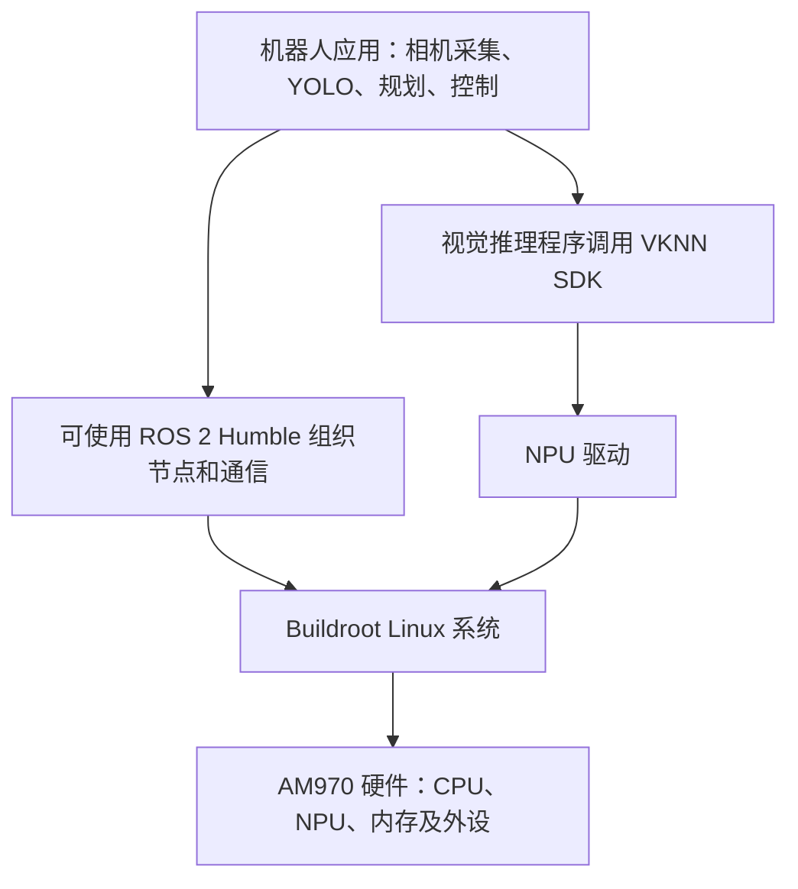

# 03 篇章学习记录与公司 AM970 开发板规格

记录日期：2026-10-29。

对应章节：`03-机器人硬件、lerobot及地瓜RDK-X5开发板控制教程`。

## 1 学习进度与后续实操平台

当前正在学习 `01RDKX5超新手入门教程.md`。已理解开发板、系统、AI 推理和 ROS 2 的基本关系；用户已在公司的开发板上完成 YOLO 测试，本次入门概念学习告一段落。

没有 RDK X5，因此没有在 RDK X5 上执行其烧录、安装和示例步骤，不能将这部分记为实操完成。

**后续实操默认使用公司的 AMICRO AM970 DVB2 开发板。** 继续按仓库章节学习，但涉及操作系统、模型部署、驱动、安装与编译的步骤，需要适配实际板端环境，不直接照搬 RDK X5 的命令。后续换板或更换固件时，应重新核实并更新本记录。

## 2 本次如何确认设备

通过 Windows 的 COM3 串口连接板端，使用只读命令读取设备树、CPU、内存、存储、系统和 ROS 安装信息，没有修改板端配置。

| 项目 | 本次确认结果 |
| --- | --- |
| Windows 端口 | COM3 |
| 转串口设备 | USB-SERIAL CH340 |
| 串口参数 | 115200 波特率，8 数据位，无校验，1 停止位（8N1） |
| 硬件流控 | 本次连接未使用 |
| 设备树型号 | `AMICRO AM970 DVB2` |
| 设备树 compatible | `amicro,am970` |

COM3 是电脑为连接分配的端口名，CH340 是 USB 转串口芯片，二者都不是板端主处理器型号。端口号以后可能变化，以设备管理器为准。

## 3 开发板实测规格

以下为 2026-10-29 通过当前板端读取的信息。标为“查询时”的项目是瞬时状态，不是固定规格。

| 类别 | 项目 | 实测结果与说明 |
| --- | --- | --- |
| 平台 | 型号 | AMICRO AM970 DVB2 |
| CPU | 核心 | 4 核 ARM Cortex-A55，修订 r2p0 |
| CPU | 架构 | ARM64 / aarch64，小端；CPU 报告支持 32 位和 64 位操作模式 |
| CPU | 核数与线程 | 4 个在线 CPU，每核 1 线程 |
| CPU | 系统报告的频率范围 | 500 MHz～1.8 GHz |
| CPU | 查询时频率 | 1.2 GHz；运行中可变化 |
| 内存 | 启动日志识别的总量 | 1 GiB，即 1,048,576 KiB；未据此推断内存品牌、类型或频率 |
| 内存 | Linux 可见总量 | 889,004 KiB，约 868 MiB |
| 内存 | 查询时可用量 | 约 787 MiB；不是长期保证值 |
| 内存 | CMA 池 | 启动日志显示 512 MiB；不能把它简单地再从 Linux 可见总量中扣掉 |
| 内存 | Swap | 本次为 0，未配置 |
| 存储 | 主存储 | eMMC，块设备 `mmcblk0`，设备名称 `08A391` |
| 存储 | 用户区容量 | 15,269,888 个 512 字节扇区，约 7.3 GiB，属于约 8 GB 标称容量级别 |
| 存储 | 根分区 | `mmcblk0p6`，ext4；分区约 5 GiB，文件系统报告约 4.9 GiB |
| 存储 | 根文件系统使用情况 | 查询时已用约 3.4 GiB、可用约 1.3 GiB，使用率 73% |
| 存储 | 数据分区 | `mmcblk0p14`，ext4，约 1.9 GiB，挂载到 `/data` |
| 系统 | 发行系统 | **Buildroot 2021.02** |
| 系统 | Linux 内核 | 5.10.59 |
| Python | 解释器 | Python 3.9.2，路径 `/bin/python3` |
| ROS | 发行版 | ROS 2 Humble |
| ROS | 安装目录 | `/opt/ros2` |
| ROS | 已读取包版本 | `ros_environment` 3.2.2，`rclcpp` 16.0.5 |
| AI 推理 | NPU 驱动线索 | 启动日志显示 `vipcore` 初始化，兼容标识 `amicro,galcore` |
| AI 推理 | VKNN 库 | 存在 `/usr/lib/libvknn.so` |
| 摄像头 | USB 识别名称 | 启动日志识别 `2MP USB Camera`；这是设备报告名称，不是本次图像质量或分辨率验收结果 |
| 网络 | 系统接口名 | `lo`、`sit0`、`wlan0`；接口存在不等于本次已验证联网 |
| 外设 | 可见 I²C 节点 | `/dev/i2c-3`、`/dev/i2c-4`、`/dev/i2c-7` |
| 视频 | 可见视频节点 | 包含 `/dev/video0`、`/dev/video1` 等多个节点；不能把节点数量当成物理摄像头数量 |

### 3.1 必须纠正的历史信息

历史公司项目记录曾描述“AM970 + Ubuntu 22.04 + ROS 2 Humble”。但当前 COM3 所连接开发板的 `/etc/os-release` 实际返回：

```text
NAME=Buildroot
VERSION=2021.02
ID=buildroot
VERSION_ID=2021.02
PRETTY_NAME="Buildroot 2021.02"
```

因此，**当前实操以 Buildroot 为准**。不要混用其他板卡、历史固件或 SDK 记录中的环境信息。当前 ROS 路径是 `/opt/ros2`，不能默认使用 `/opt/ros/humble`。

### 3.2 尚未作为实测规格确认的信息

| 项目 | 当前依据与边界 |
| --- | --- |
| NPU INT8 峰值约 5 TOPS | 来自已有项目资料；本次串口查询确认了驱动和 VKNN 库，没有独立验证峰值算力 |
| DDR 类型、频率、颗粒厂商 | 未读取到，不作推断 |
| 电源输入电压、电流要求 | 未核实，应查看板卡标识或对应硬件资料 |
| 接口数量与电气规格 | 未核实完整原理图；不能把芯片支持的接口等同于开发板实际引出的接口 |
| ROS 节点是否正在运行 | 本次只确认安装信息，没有检查节点运行状态 |
| 本次 YOLO 是否通过 ROS 2 运行 | 用户确认 YOLO 测试完成，但当前未核实其运行链路，不能仅据此认定使用了 ROS 2 |

## 4 这块板上几个软件名称分别是什么



这是一张功能关系图，不表示每个应用都必须经过 ROS 2 才能调用 SDK。

| 名称 | 含义 |
| --- | --- |
| AM970 | 板端主控 SoC 平台 |
| Buildroot | 用于构建嵌入式 Linux 系统的工具体系；当前板上的系统标识为 Buildroot 2021.02 |
| ROS 2 | 机器人软件框架及工具，提供通信、节点组织、参数、启动等能力 |
| Humble | ROS 2 的发行版名称 |
| VKNN | 当前平台使用的模型推理 SDK/库 |
| YOLO | 执行目标检测等视觉任务的模型体系 |
| NPU | 加速神经网络计算的硬件 |

## 5 本次关于 ROS 2 的理解

### 5.1 ROS 2 不只是一个“环境”

“安装 ROS 2 环境”是把框架、运行库和工具安装好。ROS 2 本身提供的是机器人应用开发与协作能力，不自动实现你的障碍物识别或运动策略。

```text
相机节点 → 图像话题 → YOLO 节点 → 检测结果话题 → 判断或规划节点
```

- 节点：承担某项功能的软件单元，例如相机采集。
- 话题：发布、订阅消息的命名通道。
- 消息：通信使用的数据格式，例如图像或速度。
- 算法：识别、规划等具体逻辑，通常由自己的应用实现。

### 5.2 没有 ROS 2 核心源码，不等于不能使用 ROS 2

开发 ROS 2 应用通常使用已经安装的库、头文件和工具，不必先下载整个 ROS 2 框架的源码。这与使用 NumPy 不需要先拿到并修改 NumPy 核心源码类似。

日常主要修改自己的节点、参数、启动文件和算法。遇到框架缺陷、特殊需求或底层性能问题时，才可能需要修改 ROS 2 核心或中间件。

推荐组织方式：

```text
/opt/ros2
    已安装的框架与依赖

单独的应用开发工作空间
    自己的功能包源码、配置与构建结果
```

这只是目录组织原则，本次没有新建板端工作空间，也没有修改 `/opt/ros2`。

### 5.3 已安装与正在使用是两回事

```text
独立推理程序：摄像头 → VKNN → 检测结果
    可以不经过 ROS 2

ROS 2 应用：相机节点 → 图像话题 → 推理节点 → 结果话题
    应用实际通过 ROS 2 协作
```

已完成的 UR5 正运动学与单摆实战脚本是普通 Python 程序，没有使用 ROS 2。板上安装 ROS 2，也不代表这些 Python 脚本会自动变成 ROS 节点。

## 6 如何用 AM970 对照学习 RDK X5 教程

| 教程环节 | 在当前板上的对应学习方式 |
| --- | --- |
| 认识开发板规格 | 使用本记录中的 AM970 实测参数，理解 CPU、NPU、内存、存储的分工 |
| 系统烧录 | 学习原理；实际刷机必须使用匹配 AM970 板型的镜像与工具，不能烧录 RDK 镜像 |
| 系统连接 | 当前已验证 COM3、115200、8N1；后续可结合实际网络配置学习 SSH |
| 软件安装 | 先检查 Buildroot 中现有组件及公司 SDK，不照搬 Ubuntu 的 apt 命令 |
| YOLO 测试 | 用户已完成；后续重点理解输入、预处理、VKNN 推理、后处理和结果输出 |
| 地瓜 BPU / hobot_dnn | 学习其推理节点组织方式；硬件调用部分需适配 AM970 的 NPU / VKNN |
| ROS 2 开发 | 使用板上 Humble；核对工具链和依赖后，再决定板端编译或电脑交叉编译 |
| 摄像头应用 | 以当前 USB 摄像头和实际设备节点为准，核实图像格式、分辨率、帧率与采集方式 |

后续实操的目标是学会同样的能力，不要求复制不同平台的命令。仅有“都是 ARM64”不足以保证程序可以直接搬过去运行，还要匹配系统库、SDK 与运行依赖。

## 7 下次复查可以使用的只读命令

以下命令在板端 Linux 控制台执行，不是在 Windows PowerShell 中直接执行：

```sh
# 读取设备型号。
cat /proc/device-tree/model

# 读取系统发行信息与内核架构。
cat /etc/os-release
uname -rmo

# 读取 CPU 核心与频率范围。
lscpu

# 读取当前内存和 Swap；可用量会变化。
free -h

# 查看存储设备、分区和根分区剩余空间。
lsblk -o NAME,SIZE,TYPE,FSTYPE,MOUNTPOINT
df -h /

# 读取已安装 ROS 的发行版记录，不据此推断节点运行状态。
cat /opt/ros2/share/ros_environment/environment/1.ros_distro.dsv

# 读取 Python 版本及 VKNN 库是否存在。
python3 --version
ls /usr/lib/libvknn.so
```

每次记录硬件与环境信息，都区分“实机读取”“历史资料”“尚未验证”。涉及当前开发板的结论优先依据最新实测结果。
