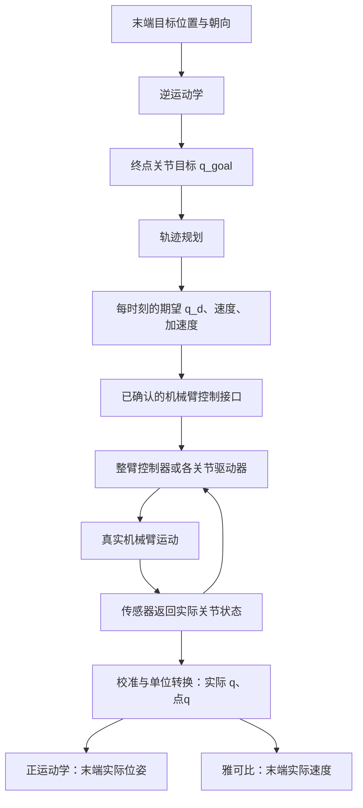

# AM970 连接机械臂与电机 ID 控制学习记录

记录日期：2026-10-29。

对应教程：[03RDK-X5连接lerobot机械臂进行遥操作](../03-机器人硬件、lerobot及地瓜RDK-X5开发板控制教程/03RDK-X5连接lerobot机械臂进行遥操作.md)。

本篇记录如何把公司的 AM970 与真实机械臂连接起来，以及电机 ID、关节角、运动学、轨迹规划和控制器之间的关系。重点是第 4 节：把前面学习的理论对应到实际控制流程。

## 1 当前已知与尚未确认的条件

- 用户手上已有机械臂，后续实操使用公司的 AM970 DVB2。
- 开发板系统为 Buildroot 2021.02、ARM64，已安装 ROS 2 Humble；详细规格见[开发板学习记录](07-03篇章学习记录与AM970开发板规格.md)。
- Windows 的 COM3 是电脑接入 AM970 控制台的串口，不是已经确认的机械臂控制接口。
- 机械臂的品牌、型号、关节结构、控制板、通信接口和协议尚未确认。
- 尚未完成机械臂设备识别、位置读取或试动。

因此，下文是接入原理和实施顺序，不能据此认定当前机械臂就是 SO-101、飞特总线舵机，或已经可以按某套电机 ID 发指令。

## 2 AM970 到底怎样让机械臂运动

```text
AM970 上的应用程序
        ↓ 通信指令
USB / 串口 / CAN / 网络等接口
        ↓
机械臂控制器或电机驱动器
        ↓ 电机执行
各关节运动
        ↓ 状态反馈
实际位置、速度、故障等信息返回应用
```

AM970 是运行程序的计算机。它通常不直接用通用接口给电机线圈供电，而是通过控制板或驱动器完成实际驱动。

不同机械臂提供的控制层次不同：

| 硬件类型 | AM970 通常需要做什么 |
| --- | --- |
| 有完整控制器与 SDK | 调用 SDK，发送关节角目标或末端位姿目标 |
| 总线舵机机械臂 | 通过匹配的通信适配器，按协议读取位置、发送目标 |
| CAN 电机组成的机械臂 | 按电机协议通信，并依据已有控制能力实现整臂逻辑 |
| 自制机械臂控制板 | 按控制板约定的协议操作，确认哪些控制功能由板内实现 |

通信接口与指令含义是两件事：“通过 CAN 连接”不等于“只能控制力矩”，“USB 连接”也不保证使用哪种舵机协议。

机械臂供电与通信也要分别确认：

```text
AM970 ──通信连接──→ 机械臂控制板
                         ↑
                  匹配规格的电源
```

不能默认 AM970 的 USB 能承担整条机械臂的电机供电。TTL、RS-232、RS-485 等接口电气标准不同，需依据实物和说明书接线。

## 3 电机 ID 的作用：找到谁，不是决定怎么运动

### 3.1 使用总线舵机时的典型结构

下面 ID 与关节名称仅用于解释，不是当前机械臂的真实配置：

```text
AM970
   ↓ 通信适配器
舵机总线
   ├── ID 1：示例肩部电机
   ├── ID 2：示例肘部电机
   └── ID 3：示例夹爪电机
```

多个电机共享通信总线，ID 用于寻址。一条指令可以概念性地拆成：

```text
发给谁：ID 2
做什么：写入目标位置
目标是多少：某个位置数值
如何执行：协议支持的速度、加速度或其他限制
```

实际报文还可能包含指令码、寄存器地址、数据长度、校验等，格式必须以设备协议为准。

**ID 只回答“找谁”，控制指令和数据回答“做什么、做到多少”。** ID 不是关节角、力矩或控制算法。

位置值可能是角度，也可能是编码器刻度。发送前必须确认单位、方向、零点、范围和控制模式。不能把数字 30 直接解释为所有电机上的 30°。

### 3.2 不一定由 AM970 直接操作每个 ID

另一种组织方式是由整臂控制器处理电机寻址：

```text
AM970：发送一组目标关节角 q_d
                 ↓
机械臂控制器：依据关节映射分配各电机目标
                 ↓
ID 1、ID 2、ID 3……执行
```

此时应用层只需要调用“移动到关节目标”的接口，不必手工组装每个电机报文。

### 3.3 端口、ID、关节变量分别是什么

| 名称 | 解决的问题 |
| --- | --- |
| 通信端口 | 从哪个通信入口访问设备？ |
| 电机 ID | 在这条总线上找哪个电机？ |
| 关节名称与顺序 | 这个电机对应机械结构中的哪一项？ |
| q 中的某个分量 | 该关节当前的角度或位移是多少？ |
| 目标指令 | 希望它移动到哪里、按什么模式工作？ |

主臂和从臂如果分别使用独立总线，两条总线上可以有相同 ID；同一总线中的寻址规则则要满足对应协议要求。

## 4 重点：和前面学的知识怎么对应

### 4.1 q 是关节变量，不是电机 ID

对于两旋转关节机械臂：

$$
q=\begin{bmatrix}\theta_1\\\theta_2\end{bmatrix}
$$

例如 q = [30°,60°]ᵀ，表示两个关节分别处于 30°、60°，不是控制 ID 30 和 ID 60。

对于六旋转关节机械臂，q 有六个角度分量；若硬件中包含夹爪，其开合变量需要按模型定义，不能因为有六个电机就认定末端一定具有六个独立位姿自由度。

程序要维护正确的对应关系：

```text
关节变量 q 的顺序
    ↓ 依据真实硬件配置映射
关节名称、电机 ID、转动方向、零点、位置单位
    ↓
实际通信指令
```

### 4.2 第一阶段：直接给关节目标，验证能不能控制

假设控制器支持关节位置指令，可以先做：

```text
程序给出目标关节角 q_d
          ↓
接口层按协议转换、发送目标
          ↓
控制器或舵机驱动关节运动
          ↓
读取实际关节角 q
          ↓
比较目标与实际是否一致
```

这里 q_d 是期望值，q 是测得或估计的实际值，二者不能因为“命令已发送”就视为相同。

例如一个关节的目标是 30°，当前反馈为 28°：

$$
e=q_d-q=30^\circ-28^\circ=2^\circ
$$

位置控制器根据误差推进运动。具体控制律、限速和停止行为由设备实现与配置决定。

第一次试动无需先实现完整逆运动学和视觉抓取。确认零点、限位和停止方式后，低速小幅测试单关节，更容易验证通信与映射是否正确。

### 4.3 正运动学：从实际关节角，知道末端在哪里

$$
T_{\mathrm{实际}}=f(q)
$$

```text
电机或控制器返回原始位置
            ↓ 校准与单位转换
实际关节角 q
            ↓ 正运动学：使用几何参数或 DH 变换链
末端实际位姿 T
```

正运动学负责“计算位置和朝向”，它本身不会给电机发命令，也不会使关节运动。

如果把目标 q_d 代入正运动学，算到的是对应的目标几何位姿；如果要估计当前末端实际位姿，应使用实际关节反馈 q，并考虑模型误差。

此前 UR5 脚本正是验证这一段：输入六个关节角，输出 4×4 末端矩阵。它没有连接机械臂，也没有驱动电机。

### 4.4 逆运动学：从末端目标，反求关节目标

当任务变成“让夹爪到达某个位置和朝向”，就不能只说“把电机 ID 2 转一下”。需要先求出一组可行关节配置：

```text
末端目标位姿 T_goal
        ↓ 逆运动学，结合结构和关节约束
可行的终点关节角 q_goal
```

位姿包括位置与朝向，三维刚体完整位姿有六个自由度。实际机械臂的结构和自由度决定哪些目标可达。

逆运动学可能有多个解，也可能没有可行解；求出的解还要满足关节限位等约束。

### 4.5 轨迹规划：从“终点”变成“整个运动过程”

只求出 q_goal，还没有安排从当前位置怎么运动过去。

```text
当前关节角 q_start + 终点关节角 q_goal
                        ↓ 轨迹规划
每一时刻的期望角度 q_d(t)
每一时刻的期望速度 点q_d(t)
每一时刻的期望加速度 两点q_d(t)
```

$$
\dot q_d(t)=\frac{dq_d}{dt},\qquad
\ddot q_d(t)=\frac{d^2q_d}{dt^2}
$$

例如一个关节从 0° 到 30°，可以规划为先加速、中间运动、末尾减速停稳，而不是要求瞬间跳到 30°。

三者描述同一条轨迹，不能独立随意指定。有的控制器内置轨迹规划，只需要终点与速度限制；有的接口需要应用按周期发送目标，应先查接口能力。

### 4.6 PID 和动力学：让真实运动跟上期望

在明确采用关节力矩控制的结构下，可以这样组织：

```text
期望角度 q_d 与实际角度 q
          ↓ 误差及其变化
PID 等反馈控制器
          ↓ 可与动力学前馈组合
关节驱动力矩 τ
          ↓ 真实机械臂的动力学
关节产生加速度、速度和位置变化
          ↓ 反馈测量
新的实际 q、点q
```

简化动力学为：

$$
M(q)\ddot q+C(q,\dot q)\dot q+g(q)=\tau
$$

这里暂时省略摩擦与外部作用。动力学模型描述力矩与运动的关系，PID 根据误差计算控制修正，它们承担不同职责。

**如果使用智能舵机的位置接口，底层可能已经处理位置闭环，AM970 主要发送目标位置。** 不应未经确认就额外叠加一套力矩 PID，也不能假定所有舵机内部都是同一种 PID 算法。

### 4.7 雅可比：把关节速度、末端速度和末端作用联系起来

$$
v=J(q)\dot q
$$

已知实际关节姿态和速度，可以通过雅可比计算末端线速度与角速度。给定末端速度目标时，也可结合约束、奇异性处理求关节速度，但不是简单保证处处都能直接求逆。

$$
\tau_F=J^TF
$$

末端力与力矩可以映射为对应的关节广义力矩。它不是完整电机力矩，不自动包含惯性、重力和摩擦；F 的方向、坐标系及参考点必须明确。

这两条关系用于后续速度控制、接触力分析等，不是首次串口试动的前置条件。

### 4.8 完整串联图



图中的底层反馈可能封装在舵机或整臂控制器内部，不一定由 AM970 自己逐步执行。读取协议和 SDK，就是为了确认这些模块的实际边界。

## 5 主从臂遥操作如何接入这条链

仓库教程的基本思路：

```text
人移动主臂
    ↓ 读取主臂关节位置
主臂校准与位置映射
    ↓ 得到从臂目标
发送从臂关节位置命令
    ↓
从臂执行与反馈
```

$$
q_{\mathrm{主臂}}\xrightarrow{\text{校准与映射}}q_{\mathrm{从臂目标}}
$$

同类结构的关节跟随可以直接基于关节位置，不一定先求末端位姿再求逆运动学。不同结构的主从系统则可能需要更复杂的映射。

这里的关节校准用于处理位置读数、零点、方向和范围，与相机和机器人坐标关系的手眼标定不同。

本篇教程关闭了摄像头配置，首先验证关节跟随，不是视觉抓取或策略训练。只有一条机械臂时，也可以学习直接关节控制，但不能不加其他输入设备就完整复现两臂遥操作。

## 6 ROS 2 和 LeRobot 放在哪里

- LeRobot 可以提供特定机械臂的设备接入、校准、遥操作及后续数据流程，是否直接适用取决于硬件支持和软件版本。
- ROS 2 用于把相机、控制、规划等功能组织成可通信的节点，不自动提供当前机械臂的驱动。
- 首次通信不一定需要 ROS 2 或 LeRobot；如果厂商有独立 SDK，可以先用其最小示例读状态、发位置目标。

```text
可选的上层组织：ROS 2 节点 / LeRobot / 自己的程序
                          ↓
设备 SDK 或协议实现
                          ↓
机械臂控制器与电机
```

AM970 运行 Buildroot，不应照搬教程中的 Ubuntu 安装命令。SDK 需要匹配 ARM64、系统库与驱动；仅架构相同不足以保证二进制兼容。

## 7 真实接入的实施顺序

| 阶段 | 需要做什么 | 完成标志 |
| --- | --- | --- |
| 1. 确认硬件 | 获取型号、控制板、接口、电源规格、SDK/协议 | 知道设备如何通信、接受哪些命令 |
| 2. 建立连接 | 按资料接线，查设备枚举或网络连接 | 找到正确设备入口 |
| 3. 只读验证 | 读取电机 ID、当前位置、故障等信息 | 稳定得到可信反馈 |
| 4. 核实映射 | 确认关节名称、ID、单位、正方向、零位和限位 | 命令数值对应清楚的物理含义 |
| 5. 单关节试动 | 固定机械臂、留出空间、准备停止方式，低速小幅移动 | 正确关节按预期运动且可停止 |
| 6. 多关节目标 | 协调发送目标并检查实际反馈 | 整臂运动与目标一致 |
| 7. 上层扩展 | 根据任务接入遥操作、ROS 2、运动学或视觉 | 完成所需应用流程 |

本次仅整理学习内容，尚未确定真实电机 ID、接口协议或发送任何机械臂运动指令。

## 8 复习时记住这四句话

1. **ID 找到电机，指令规定动作，目标数值需要按协议与校准解释。**
2. **正运动学从实际关节角算末端位姿；逆运动学从末端目标求关节目标。**
3. **轨迹规划安排沿途每个时刻的期望状态，控制器让实际运动跟上它。**
4. **AM970 要实现哪层控制，取决于机械臂控制器已经提供了哪些能力。**
