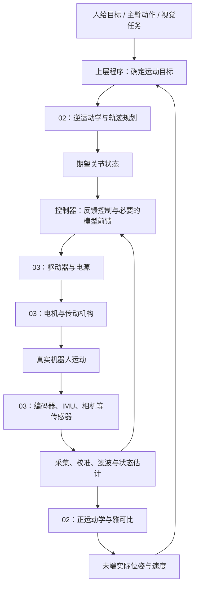
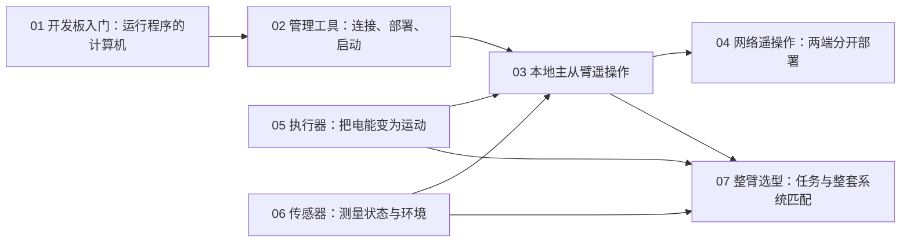
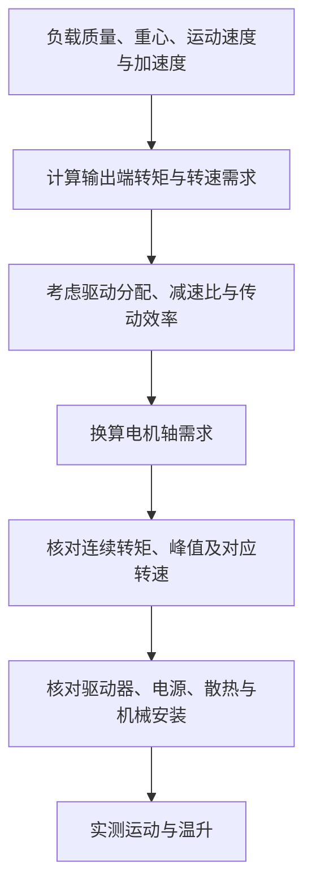
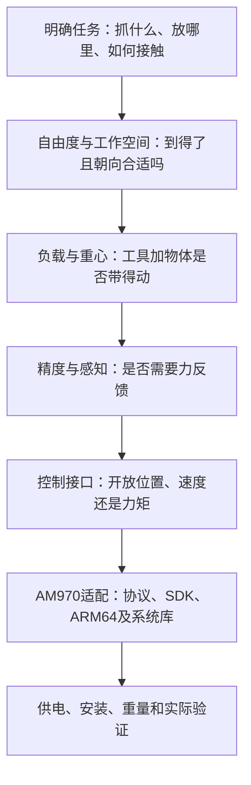

# 03 篇章总结图解：把理论接到真实机器人上

整理日期：2026-10-30。

对应目录：`03-机器人硬件、lerobot及地瓜RDK-X5开发板控制教程`。

阅读目标：看清开发板、机械臂、执行器、传感器和软件各自负责什么，以及它们如何实现 02 篇章中的数学关系。

## 1 用一张图连接 02 与 03

**02 篇章主要建立描述、计算和控制运动的方法；03 篇章认识承载这些方法的硬件、接口和软件。**



这是功能分工图，不表示全部功能都必须由 AM970 执行。有的机械臂控制器已经完成规划与控制，有的智能舵机内部就有位置闭环。

| 02 中的概念 | 03 中对应的实际对象或工作 |
| --- | --- |
| 关节角 q | 由编码器读数经过方向、零点和单位转换得到 |
| 目标关节角 q_d | 通过 SDK 或通信协议发送给控制系统 |
| 正运动学 | 结合实际结构参数，由 q 算末端位姿 |
| 逆运动学 | 把末端目标换算成可行关节目标 |
| 轨迹规划 | 安排运动过程，满足速度、加速度等约束 |
| 动力学所需力矩 τ | 电机与传动系统需要实际提供的能力 |
| PID 的反馈值 | 来自传感器或状态估计，不是命令值本身 |
| 雅可比 J(q) | 将实际关节速度联系到末端速度 |
| 末端力映射 JᵀF | 分析末端作用对应的关节力矩 |
| 手眼标定 | 建立实际相机与机器人坐标系之间的固定关系 |

## 2 03 各篇在全局中处于什么位置



| 文档 | 学到的核心能力 |
| --- | --- |
| 01 RDK X5 入门 | 认识开发板、系统、推理程序与硬件加速器的关系 |
| 02 RDK Studio | 理解烧录、连接、部署、启动和查看结果的工作流程 |
| 03 LeRobot 遥操作 | 理解主臂读取、校准映射、从臂执行的链路 |
| 04 双臂异构遥操作 | 理解网络连接两端、网页服务与硬件控制的分工 |
| 05 执行器原理与选型 | 从负载和运动要求计算转矩、转速，再核对驱动能力 |
| 06 传感器与采集 | 认识接口、测量误差，以及滤波和融合的作用 |
| 07 机械臂选型 | 综合判断可达性、负载、精度、控制接口与系统适配 |

## 3 我们实际使用的计算平台：AM970

教程围绕 RDK X5 展开，但后续实操默认使用公司的 **AMICRO AM970 DVB2**。

```text
Windows 电脑
    │
    ├── COM3 / CH340 / 115200 8N1 → AM970 Linux 控制台
    │                                  │
    │                                  ├── Buildroot 系统
    │                                  ├── ROS 2 Humble
    │                                  └── VKNN 与 NPU
    │
    └── 网络连接 → 需依据实际 IP、服务和网络状态配置
```

此前实测：4 核 Cortex-A55，最高 1.8 GHz；启动日志识别 1 GiB 内存，Linux 可见约 868 MiB；约 8 GB 标称容量级别 eMMC；Buildroot 2021.02、Linux 5.10.59、Python 3.9.2；ROS 2 安装于 `/opt/ros2`。

这些数据来自 2026-10-29 的检查，本次总结没有重新读取板端状态。详情与未确认规格见[07-AM970规格记录](07-03篇章学习记录与AM970开发板规格.md)。

**COM3 是电脑接入开发板控制台的端口，不是已经验证的机械臂舵机端口。** 后续机械臂若接在 AM970 上，要在板端识别相应设备接口。

RDK 的烧录镜像、BPU 接口、Studio 工具和 Ubuntu 安装命令不能直接套用。学习的是它们承担的功能，实施则要匹配 AM970 的系统与 SDK。

## 4 软件分层：系统、ROS 2、LeRobot、算法不是同一层

```text
你的应用：检测物体、读取主臂、规划动作、控制关节
           │
           ├── 可用 ROS 2：组织节点、传递消息、管理参数
           ├── 可用 LeRobot：适配支持的机器人、遥操作与数据流程
           └── 可直接调用厂商 SDK 或自行实现协议
                         ↓
系统库、驱动与 Buildroot Linux
                         ↓
AM970 CPU、NPU、通信接口及外部硬件
```

- ROS 2 是框架、库和工具，Humble 是发行版。日常主要开发自己的节点，不修改框架核心。
- 没有 ROS 2 核心源码，不等于不能开发 ROS 2 应用；需要匹配的运行环境及开发依赖。
- LeRobot 与 ROS 2 不是必须串联的两层，本章遥操作可以直接通过设备驱动进行。
- YOLO 是模型，VKNN 是当前平台的推理接口，NPU 是执行加速计算的硬件。
- 安装了 ROS 2，不等于当前 YOLO 或其他程序正在使用 ROS 2。
- 原有 UR5、单摆练习是普通 Python 程序，没有使用 ROS 2。

RDK Studio 的意义是把连接、部署等工作放到图形界面。对我们的 AM970，理解这些流程即可，无需为了复现界面而更换工具或系统。

## 5 遥操作：运动目标来自人的动作

### 5.1 本地主从臂

```text
人移动主臂
    ↓
读取主臂编码器位置
    ↓ 校准、单位转换、关节映射
生成从臂目标 q_d
    ↓ 通信接口与驱动
从臂执行，返回实际状态 q
```

对于适合直接关节映射的主从结构，可以不经过“末端位姿 → 逆运动学”这条路径。若结构不同，就需要根据任务另设计映射。

### 5.2 网络遥操作为什么分成 Windows 和 Linux

```text
操作者一侧                            机器人一侧

左主臂 → Windows ──位置数据／网络──→ Linux → 左从臂
右主臂 → Windows ──位置数据／网络──→ Linux → 右从臂
```

第 04 篇完整配置有两条主臂、两条从臂，共四条臂。“双臂”主要指左右执行臂，不是整个系统只有两条臂。

两端分开是为了允许人在一处、机器人在另一处。Windows 与 Linux 是作者采用的组合，不是遥操作的必要条件：

- 同桌实验可以把主从臂都接在同一台设备上。
- 需要远程操作时再增加网络传输。
- 网页负责管理与显示，后台程序持续读取、传输和控制。
- 网络引入延迟、中断与消息同步问题，需要规定失联时如何处理。

原文的 HTTP 示例只推送一次样例值，不等于已经实现持续读取主臂的完整程序。其服务脚本、版本和路径也需要核对，不能仅复制 Markdown 就认定系统可运行。

### 5.3 ID、目标和控制分别是什么

```text
通信端口：从哪里进入设备？
电机 ID：找哪一个电机？
目标位置：希望它到哪里？
控制器：怎样调节驱动使它到达？
反馈：实际到了哪里？
```

ID 是地址，不是角度，也不是运动算法。命令中的位置数值可能是角度、编码器刻度或约定的归一化数值，必须看协议和校准。

整臂控制器可能已经把关节目标拆成各电机命令，此时 AM970 无需直接操作每个电机 ID。我们的机械臂具体型号、控制板与接口仍待确认。

## 6 执行器：动力学算出的需求由硬件实现

### 6.1 从任务要求到电机能力



机械臂关节的简化需求：

$$
\tau_{\mathrm{需求}}\approx\tau_{\mathrm{重力}}+I\alpha+\tau_{\mathrm{摩擦}}
$$

这里的 I 是转动惯量。执行器文档用 J 表示惯量时，不要把它当成雅可比矩阵 J(q)。多关节系统完整计算还涉及耦合项等。

教学例子：末端 1 kg 物体距轴 0.2 m，0.5 kg 连杆重心距轴 0.1 m，水平保持时：

$$
\tau_{\mathrm{保持}}=1\times9.81\times0.2+0.5\times9.81\times0.1
=2.4525\ \mathrm{N\cdot m}
$$

再计入示例中的加速与摩擦，输出端需求约 2.65 N·m；这不是我们实际机械臂的测量结果。

### 6.2 减速机把需求连接到电机轴

$$
i=\frac{n_m}{n_{out}},\qquad n_m=i n_{out},\qquad
\tau_m\approx\frac{\tau_{out}}{i\eta}
$$

```text
电机轴：较高转速、较小转矩
              ↓ 减速机，效率小于 1
输出轴：较低转速、较大转矩
```

减速机不创造功率。电机及减速机各自的承载、转速和温升限制都要满足。

### 6.3 小车代码与机械臂选型是同一种思路

```text
机械臂：重力矩 + 惯性矩 + 摩擦矩 → 关节输出需求

小车：加速力 + 坡度阻力 + 运动阻力 → 总牵引力
                                        ↓ 乘轮半径
                                   轮侧总转矩需求
```

$$
F=ma+mg\sin\beta+\mu mg\cos\beta,\qquad
\tau_{wheel}=Fr,\qquad \omega_{wheel}=v/r
$$

文档例子约为轮侧总需求 1.59 N·m、轮速 191 rpm。存在多个驱动轮和减速机时，必须先分配再换算，才能与单台电机比较。

**连续转矩、短时峰值转矩和堵转转矩不能混用。** 需求点落在简化特性线下方，不等于可以长期安全工作。

完整计算和代码原文解释见[09-执行器与电机选型记录](09-执行器原理与电机选型学习记录.md)。

## 7 传感器：反馈值不是程序凭空知道的


| 传感器 | 测量或提供的信息 | 与前章的联系 |
| --- | --- | --- |
| 编码器 | 转轴位置；可进一步估算速度 | 得到实际 q、点 q，供反馈和运动学使用 |
| 陀螺仪 | 角速度 | 积分预测朝向变化，但偏差会累积 |
| 加速度计 | 比力；适当条件下可推算重力方向 | 提供倾斜角参考，不直接输出关节角 |
| 相机 | 图像；经算法可获得目标信息 | 结合视觉估计、坐标变换与手眼标定 |
| 雷达等距离传感器 | 距离、点云等 | 环境感知、定位、避障 |
| 力／力矩传感器 | 接触作用 | 与 JᵀF 映射及力控联系 |

同样是角度，不同传感器的角度可能属于不同对象和坐标系。IMU 估计的机身倾斜角不能直接作为所有机械臂关节的 q。

### 7.1 IMU 实战图的四条线


该图是代码模拟结果，不是当前 AM970 的传感器实测。

| 曲线 | 含义 | 为什么是这个样子 |
| --- | --- | --- |
| 红色虚线 | 设定的真实角度 | ±10°正弦摆动，2 秒一个周期 |
| 浅绿色线 | 模拟加速度计换算出的倾斜角 | 加入了标准差 2° 的随机误差 |
| 灰色虚线 | 纯陀螺仪积分 | 角速度中人为加入 +0.5°/s 偏差，10 秒累积约 +5° |
| 蓝色实线 | 互补滤波估计 | 保留运动跟随，并不断接受倾斜角观测校正 |

本例直接模拟倾斜角观测，省略了真实加速度计原始数据到角度的换算。它适合说明原理，不是完整三维姿态解算器。

### 7.2 为什么蓝线不会跟灰线一起漂

$$
\theta_{pred,k}=\hat\theta_{k-1}+\omega_k\Delta t
$$

$$
\hat\theta_k=\alpha\theta_{pred,k}+(1-\alpha)\theta_{acc,k}
$$

```text
上次融合结果 ──加上本次转动──→ 本次预测 ──×0.98──┐
                                                ├→ 新融合结果
本次加速度计角度观测 ───────────────────×0.02───┘
                                                     │
                                                     └→ 下一轮
```

这不是把一直漂移的灰线和绿线简单相加。每次预测从上次已经校正的蓝线开始。

如果预测为 12°、观测为 10°：

$$
\hat\theta=12+0.02(10-12)=11.96^\circ
$$

本轮只修正 0.04°，但之后每轮都继续校正。它既不完全跟随单次噪声，也能持续抑制积分漂移，仍会存在残余误差。

α 的效果与采样间隔有关。加速度计受运动加速度干扰时也不能当成绝对真值；仅靠重力不能确定航向角。

### 7.3 与 PID 的连接

$$
e=q_d-q_{\mathrm{反馈}}
$$

```text
传感器噪声大 → 反馈值乱跳 → 误差与控制输出可能抖动
滤波过强    → 反馈滞后   → 控制效果也可能变差
```

所以信号处理不是“越平滑越好”，要在噪声与延迟之间按任务权衡，不能只凭曲线好看判断控制性能。

## 8 机械臂选型：最终检查整套系统是否匹配任务



读参数表时应区分：

- 臂展不等于范围内任意位置、任意朝向都可达。
- 负载包括末端工具、相机、安装件和物体，还要看重心与工况。
- 重复定位精度是反复到达的一致性，不等于绝对坐标准确度。
- 关节力矩传感器、末端力传感器与电流估算不是一回事。
- 内部控制频率、外部命令频率与状态反馈频率不是同一个指标。
- 360°转动范围不自动等于可以无限连续旋转。

原文产品表存在型号、版本与比较口径混用，价格和品牌标签不作为本记录确认的规格。先学选型维度，实际选到型号后再查对应资料。

对已有机械臂，优先明确：准确型号、控制板、通信方式、电源、关节映射、指令单位、反馈能力，以及 SDK 是否支持当前系统。

## 9 把“看见物体并抓取”完整走一遍

```text
相机采集图像                         ← 03：传感器、接口
       ↓ 视觉估计
得到目标在相机中的三维位姿           ← 检测框本身不等于三维位姿
       ↓ 手眼关系与坐标变换
目标在机器人基座中的位姿             ← 02：坐标变换、手眼标定
       ↓ 加入夹爪与抓取偏移
夹爪目标位姿
       ↓ 逆运动学
可行关节终点                         ← 02：运动学
       ↓ 轨迹规划
各时刻期望角度、速度、加速度
       ↓ 控制器与接口
执行指令                             ← 02：控制；03：协议与SDK
       ↓ 电机、驱动器、减速机
真实运动                             ← 03：执行器；02：动力学
       ↓ 编码器等采集、校准与处理
实际状态反馈                         ← 03：传感器
       ↓
持续比较、修正，并用正运动学监测末端
```

这是一条目标系统链路，不表示当前已完成视觉抓取。对于已封装控制能力的机械臂，其中一些环节由控制器内部实现。

## 10 本阶段已完成与下一步边界

### 已完成的学习和验证

- 已读完 03 篇章，理解各部分用途及与 02 的联系。
- 已通过串口读取 AM970 型号、系统、CPU、内存、存储和 ROS 安装信息。
- 用户已完成板端 YOLO 测试；本轮学习未重新核实该测试是否经过 ROS 2。
- 已学习本地与远程遥操作架构、电机 ID、校准与关节目标。
- 已讲解电机选型计算器及 IMU 互补滤波结果图。

### 尚未完成的实操

- 尚未确认实际机械臂型号、协议和控制板。
- 尚未通过 AM970 读取机械臂关节状态或发送试动命令。
- 尚未部署教程的完整 LeRobot 主从臂、四臂网络遥操作系统。
- 传感器融合图来自教材模拟，并非本次板端 IMU 数据。

### 下一步真实机械臂接入顺序

```text
确认型号与协议
    ↓
确认供电与连接
    ↓
只读查询设备与关节状态
    ↓
核对 ID、零位、方向、单位、限位和停止方式
    ↓
固定设备并低速小幅测试单关节
    ↓
多关节控制
    ↓
按需要增加运动学、遥操作、ROS 2 或视觉
```

不必为了复现章节顺序，先搭建复杂网络系统；先让一条已知控制链路可靠工作。

## 11 复习导航

| 想复习什么 | 对应记录 |
| --- | --- |
| 02 的完整理论链 | [06-02篇章完整串联图解](06-02篇章完整串联图解.md) |
| AM970 的实测配置与系统差异 | [07-AM970规格与03入门](07-03篇章学习记录与AM970开发板规格.md) |
| 机械臂接入、ID 与运动控制对应 | [08-AM970连接机械臂](08-AM970连接机械臂与电机ID控制学习记录.md) |
| 转矩、转速与代码逐步解释 | [09-执行器与电机选型](09-执行器原理与电机选型学习记录.md) |

复习时可沿着“目标从哪里来 → 程序怎么算 → 指令怎么传 → 硬件怎么动 → 状态怎么测 → 误差怎么修正”讲一遍。每一段都能指出对应知识和实际设备，就把 02 与 03 串起来了。
