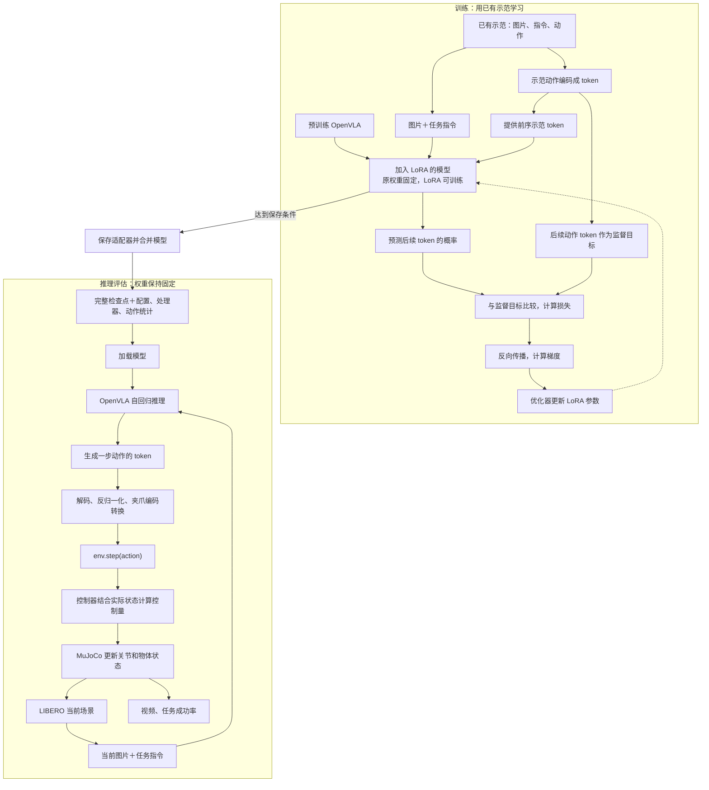
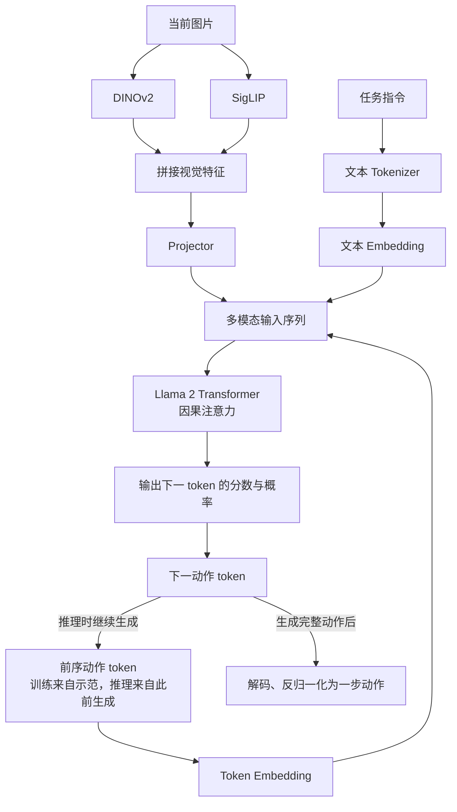

# OpenVLA 训练样本与参数更新学习记录

记录日期：2026-11-12。

本篇单独记录原版 OpenVLA 的训练学习，承接 [19-OpenVLA复现与动作Token学习记录.md](19-OpenVLA复现与动作Token学习记录.md)。

可对照前面的 [18-SmolVLA训练数据配对与学习目标记录.md](18-SmolVLA训练数据配对与学习目标记录.md)，理解两种模型在训练目标上的区别。

本地源码：`E:\cpp_project\openvla`，当前阅读版本为 `c8f03f4`。下文代码跳转按本地文件行号整理；其他 Markdown 阅读器若不支持行号链接，可按文件路径和函数名定位。

本次属于原理讲解与源码阅读，没有启动 OpenVLA 训练，也不代表环境、权重和数据已经准备完成。

## 1. 本次重点：输入里有答案，为什么不是直接抄答案？

前面已经看懂 OpenVLA 怎样生成动作 token、还原数值、交给环境执行。现在进入训练代码，重点回答：

> 训练输入里已经放了示范动作 token，模型为什么不是直接抄答案？

要沿着以下过程看：

```text
图片、任务指令、配对的示范动作
              ↓
动作编码成 token
              ↓
构造 input_ids 与 labels
              ↓
屏蔽不需要计算预测损失的位置
              ↓
因果注意力与预测目标移位
              ↓
预测动作 token，计算损失
              ↓
反向传播与参数更新
```

## 2. 先从数据集中取出图片、指令和动作

[打开训练样本转换函数：第 38 行](E:/cpp_project/openvla/prismatic/vla/datasets/datasets.py:38)。

```python
dataset_name, action = rlds_batch["dataset_name"], rlds_batch["action"][0]
img = Image.fromarray(rlds_batch["observation"]["image_primary"][0])
lang = rlds_batch["task"]["language_instruction"].decode().lower()
```

分别取出：

```text
dataset_name → 样本属于哪个数据集。
action       → 配对好的示范动作。
img          → 当前观察图片。
lang         → 任务文字。
```

仍然是前面学过的对应关系：

```text
当时看到什么＋要完成什么任务
                ↕
       示范者接下来做了什么
```

`.decode().lower()` 将任务文字从字节形式转换为字符串，并转成小写。

这里的动作来自已经采集、配对好的示范记录，不是在这一行代码中通过当前模型与环境交互临时生成的监督答案。

## 3. 将任务和示范动作整理成“问题＋回答”

[查看第 45 行](E:/cpp_project/openvla/prismatic/vla/datasets/datasets.py:45)。

```python
conversation = [
    {"from": "human", "value": f"What action should the robot take to {lang}?"},
    {"from": "gpt", "value": self.action_tokenizer(action)},
]
```

可以理解为：

```text
问题：
    为了完成“拿起杯子”，机器人应该采取什么动作？

示范回答：
    示范动作编码后的 token 序列。
```

例如：

```text
问题文字 → P₁、P₂、……、Pₙ
动作编码 → A₁、A₂、……、A₇
```

这里的 `A₁` 等只是教学符号，代表动作 token，不是自然语言句子。七个动作 token 在这个例子中对应同一步动作的七个分量，不是未来七步。

代码中的 `"gpt"` 是这个提示词构造接口使用的回答角色名，**不是调用外部 GPT 服务**。这里仍然是在本地构造 OpenVLA 的训练样本。

## 4. `input_ids` 和 `labels` 分别是什么？

[查看第 54 行](E:/cpp_project/openvla/prismatic/vla/datasets/datasets.py:54)。下面对链式调用进行了换行，计算含义与原代码一致：

```python
input_ids = self.base_tokenizer(
    prompt_builder.get_prompt(),
    add_special_tokens=True,
).input_ids

labels = list(input_ids)
```

| 变量 | 用途 |
|---|---|
| `input_ids` | 作为模型输入的 token 编号序列 |
| `labels` | 计算损失时，告诉程序应该预测哪个 token |

此时 `labels` 确实先复制了一份 `input_ids`。

为了把位置关系画清楚，省略具体提示词格式与部分特殊符号，临时用三个动作分量演示：

```text
input_ids：
[P₁, P₂, A₁, A₂, A₃, EOS]

初始 labels：
[P₁, P₂, A₁, A₂, A₃, EOS]
```

`EOS` 表示序列结束。这个例子只是缩短序列来讲解，不是把实际机器人动作接口改成三维。

看到这里容易产生疑问：输入和标签一样，不就是抄写吗？

**还不能这样判断，因为接下来有“屏蔽损失”和“预测位置移位”两件事。**

## 5. 先屏蔽不需要学习预测的提示词部分

[查看第 63 行](E:/cpp_project/openvla/prismatic/vla/datasets/datasets.py:63)。

```python
labels[: -(len(action) + 1)] = IGNORE_INDEX
```

其中：

```python
IGNORE_INDEX = -100
```

如果动作有七个分量，`len(action) + 1` 对应这份样本构造约定下的七个动作 token 加一个结束 token。更前面的提示词标签设为 `-100`。

沿用三个动作分量的简化例子：

```text
input_ids：
[P₁,   P₂,   A₁, A₂, A₃, EOS]

labels：
[-100, -100, A₁, A₂, A₃, EOS]
```

含义是：

```text
提示词部分：
    作为条件使用，不要求模型通过这份训练损失复述它。

动作部分：
    需要学习预测。

结束 token：
    是否学习，由 predict_stop_token 配置决定。
```

**`-100` 是损失计算的忽略标记，不是机器人动作，也不是把对应输入删除。**

提示词仍然可以被模型读取，只是“预测提示词是否正确”不计入这里的监督损失。损失标签屏蔽与注意力可见性不是同一件事。

## 6. 关键：当前输入位置预测的是下一个 token

数据转换代码第 58 行已经注明：使用语言模型的 `labels` 接口时，移位在模型内部完成。

仍用这个输入序列：

```text
[P₁, P₂, A₁, A₂, A₃, EOS]
```

训练时真正比较的是：

| 用于产生预测的输入位置 | 该预测对应的下一个目标 |
|---|---|
| `P₁` | `P₂`，但提示词目标被忽略 |
| `P₂` | 第一个动作 token `A₁` |
| `A₁` | 第二个动作 token `A₂` |
| `A₂` | 第三个动作 token `A₃` |
| `A₃` | `EOS`，取决于配置 |

重点看：

```text
输入位置 P₂ 的输出 → 预测 A₁
```

**预测 `A₁` 时，用的不是 `A₁` 自己所在输入位置的输出，而是它前一个位置的输出。**

配合因果注意力：

```text
预测 A₁：
    可以利用图片、提示词。
    不能读取后面的 A₁、A₂、A₃。

预测 A₂：
    可以利用图片、提示词、示范中的 A₁。
    不能读取 A₂、A₃。

预测 A₃：
    可以利用图片、提示词、示范中的 A₁、A₂。
    不能读取 A₃。
```

因此，虽然整条示范序列一起送入模型，**每个预测位置只能利用允许看到的前缀，不能提前看到自己要预测的答案。**

需要区分两种“当前位置”：某输入位置可以利用该位置本身的输入，但这个位置的输出用于预测下一个位置的目标。不能将“输入位置能看到自己”误认为“能看到自己要预测的下一个 token”。

这就是为什么 `labels = list(input_ids)` 不等于训练模型原样复制输入。

## 7. 训练和推理的前序动作 token，来源不同

```text
训练时：
图片＋指令＋示范中的 A₁
             ↓
          预测 A₂

推理时：
图片＋指令＋模型自己生成的 Â₁
             ↓
          预测 Â₂
```

训练中使用示范前序 token 的方式，通常称为 **Teacher Forcing（教师强制）**。

它允许一次前向计算处理多个预测位置，不必像推理一样等生成第一个 token 后，再进行下一次生成。计算可以并行，不表示允许违反因果掩码去看未来答案。

但两者存在实际差别：

```text
训练时：
    前面的 token 通常来自示范。

推理时：
    前面的 token 可能已经预测错了。
```

因此，训练中的 token 准确率不错，不能替代真正的闭环任务评估。

## 8. 图片在哪里？为什么 `input_ids` 里看不到图片？

图片不是直接塞进这条整数编号序列里的。

[查看样本返回值：第 67 行](E:/cpp_project/openvla/prismatic/vla/datasets/datasets.py:67)。主要内容为：

```text
pixel_values → 图片张量。
input_ids    → 提示词和动作 token 编号。
labels       → 监督标签，其中部分位置为 -100。
```

图片和 token 分两条路径进入模型：

```text
pixel_values
    ↓
视觉编码器
    ↓
Projector
    ↓
图像特征向量 ─────────┐
                     ├──→ 组合成多模态输入序列
input_ids            │
    ↓                │
Embedding ───────────┘
```

代码入口：

- [视觉特征提取和投影：第 365 行](E:/cpp_project/openvla/prismatic/extern/hf/modeling_prismatic.py:365)
- [多模态输入序列拼接：第 383 行](E:/cpp_project/openvla/prismatic/extern/hf/modeling_prismatic.py:383)
- [图像位置标签的处理：第 392 行](E:/cpp_project/openvla/prismatic/extern/hf/modeling_prismatic.py:392)

图片对应的标签也设为 `-100`，表示这里不要求模型预测图片 token 的正确编号，而是利用图片特征帮助预测动作。

**图片位置没有直接的预测损失，不代表视觉部分必然被冻结。** 动作损失仍然可以通过计算链路影响允许训练的视觉参数，是否更新还要看冻结配置。

## 9. 损失怎样接回参数更新？

[查看微调脚本第 259 行附近](E:/cpp_project/openvla/vla-scripts/finetune.py:259)。

模型接收 `labels`，返回：

```python
loss = output.loss
```

这里的训练损失对应前面讨论的动作 token 等有效标签位置上的预测目标。

接着在 [第 264 行](E:/cpp_project/openvla/vla-scripts/finetune.py:264) 执行：

```python
normalized_loss = loss / cfg.grad_accumulation_steps
normalized_loss.backward()
```

这里的 `normalized_loss` 是为了梯度累积而按累积步数缩放损失，不是动作归一化或反归一化。

达到梯度累积条件后，在 [第 314 行开始的代码](E:/cpp_project/openvla/vla-scripts/finetune.py:314) 中更新参数：

```python
optimizer.step()
optimizer.zero_grad()
```

分别是执行优化器更新、清空梯度。清空梯度不会清空刚学到的模型权重。

这里与 SmolVLA 学过的参数更新过程相通：前向计算产生损失，反向传播计算参数梯度，优化器再更新允许训练的参数。

## 10. 把整个训练样本处理与更新流程串起来

```text
图片＋指令＋配对的示范动作
                ↓
示范动作编码成 token
                ↓
构造 input_ids 和 labels
                ↓
屏蔽提示词、图像等不计算预测损失的位置
                ↓
因果注意力＋预测目标移位
                ↓
计算动作 token 的预测损失
                ↓
反向传播
                ↓
达到累积条件后，优化器更新可训练参数
```

本节的核心结论：

> `input_ids` 决定模型读什么，`labels` 决定哪些预测需要评分；移位和因果注意力共同保证模型是在预测后续动作 token，而不是直接抄当前答案。

## 11. 当前学习进度

已经展开：

- 示范数据中的图片、语言与动作怎样被取出。
- 提示词与动作 token 怎样组成训练序列。
- `input_ids` 和 `labels` 的不同职责。
- 为什么先复制标签，再把部分位置设为 `-100`。
- 下一 token 预测的移位关系与因果掩码。
- Teacher Forcing 与真实推理的区别。
- 图片特征怎样接入语言模型，为什么图像标签被忽略仍不等于冻结视觉参数。
- 预测损失怎样经过反向传播与梯度累积，最终更新参数。

这些内容完成的是训练数据与损失链路的理解。模型初始化、具体可训练参数设置、微调命令和实际环境运行可以继续按需展开；本篇不将源码阅读记作已经完成训练实操。

## 12. OpenVLA 微调中的 LoRA：到底修改哪些参数？

前面已经串起：

```text
示范数据 → 动作 token → 预测损失 → 反向传播 → 更新参数
```

接下来的问题是：模型有这么多参数，微调时需要全部修改吗？

本地微调脚本默认采用 **LoRA**。核心做法是：保留原来的基础权重，额外训练少量用于修正计算结果的参数。

### 12.1 先加载已经训练好的 OpenVLA

[模型路径配置：第 78 行](E:/cpp_project/openvla/vla-scripts/finetune.py:78)：

```python
vla_path: str = "openvla/openvla-7b"
```

[加载模型：第 156 行](E:/cpp_project/openvla/vla-scripts/finetune.py:156) 调用 `AutoModelForVision2Seq.from_pretrained(...)`，从已有模型开始微调，不是从随机参数训练整个模型。

```text
预训练 OpenVLA
      ↓
已有的视觉、语言和动作相关能力
      ↓
用自己的示范进一步适配
```

### 12.2 LoRA 在层内部增加什么？

将一个线性层简化为：

$$
y=Wx
$$

- $x$：输入特征。
- $W$：原权重矩阵。
- $y$：输出特征。

普通全参数微调可以直接更新 $W$。LoRA 冻结 $W$，增加两个较小的可训练矩阵 $A$、$B$，计算变成：

$$
y=Wx+sBAx
$$

$s$ 是缩放系数。这里的 $A$ 是 LoRA 矩阵，不是此前流匹配例子中表示示范动作的符号。

```text
                   ┌── 原权重 W ──────────┐
输入特征 x ────────┤                      ├── 相加 → 输出 y
                   └── 小矩阵 A → 小矩阵 B ┘
                       可训练      可训练
```

原来的计算仍保留，新增分支学习如何修正它。[PEFT 官方 LoRA 说明](https://huggingface.co/docs/peft/main/en/conceptual_guides/lora)

### 12.3 为什么两个小矩阵能减少训练参数？

假设某层原权重形状为 `[4096, 4096]`，共有：

$$
4096\times4096=16,777,216
$$

个参数。

假设 LoRA 中间维度，也叫秩 `r`，设为 `32`：

```text
A：[32, 4096]
B：[4096, 32]
```

新增参数量：

$$
32\times4096+4096\times32=262,144
$$

相当于原矩阵参数量的：

$$
\frac{262,144}{16,777,216}=\frac{1}{64}
$$

这是一个假设线性层的计算，不是整个 OpenVLA 的可训练参数实测结果。

两个小矩阵形成的修正矩阵：

$$
\Delta W=sBA
$$

虽然形状与 $W$ 相同，但表达能力受到中间维度 `r` 的限制。因此是用较少参数表达权重修正，而不是自由修改原矩阵的每个元素。

### 12.4 本地脚本怎样启用 LoRA？

[默认配置：第 98 行](E:/cpp_project/openvla/vla-scripts/finetune.py:98)：

```python
use_lora: bool = True
lora_rank: int = 32
lora_dropout: float = 0.0
```

[配置与模型包装：第 172 行](E:/cpp_project/openvla/vla-scripts/finetune.py:172)：

```python
lora_config = LoraConfig(
    r=cfg.lora_rank,
    lora_alpha=min(cfg.lora_rank, 16),
    lora_dropout=cfg.lora_dropout,
    target_modules="all-linear",
    init_lora_weights="gaussian",
)

vla = get_peft_model(vla, lora_config)
```

| 参数 | 作用 |
|---|---|
| `r` | 控制 LoRA 中间维度，影响可训练参数量 |
| `lora_alpha` | 控制修正分支的缩放 |
| `target_modules` | 指定向哪些模块加入 LoRA |

这里使用 `target_modules="all-linear"`，按 PEFT 匹配规则向符合条件的线性层加入 LoRA，不能理解成只在最后动作输出处增加一个小网络。

随后 `vla.print_trainable_parameters()` 打印实际可训练参数量。

[优化器参数选择：第 188 行](E:/cpp_project/openvla/vla-scripts/finetune.py:188)：

```python
trainable_params = [
    param for param in vla.parameters()
    if param.requires_grad
]
optimizer = AdamW(trainable_params, lr=cfg.learning_rate)
```

优化器接收的是允许训练的参数。

### 12.5 基础权重不变，模型为什么能学会新动作？

因为有效计算发生了变化：

```text
原来：输出 = Wx

加入 LoRA 后：输出 = Wx + 学到的修正
```

即使 $W$ 不变，修正项变化后，中间特征和最终动作 token 的预测概率也会改变。

```text
同一张图片和指令
       ↓
经过加入 LoRA 的模型
       ↓
动作 token 的预测概率变化
       ↓
更可能生成示范所要求的动作
```

与此前 SmolVLA 的具体配置对照：

| 配置 | 如何适配新数据 |
|---|---|
| 前面讨论的 SmolVLA 配置 | 冻结 VLM，训练动作专家及相应投影模块 |
| 当前 OpenVLA LoRA 配置 | 冻结基础权重，在选定线性层训练低秩修正参数 |

这是具体配置的比较，不代表两种模型永远只能采用这两种方式。

LoRA 减少的是可训练参数及相关训练开销。完整基础模型仍需要加载、参与计算，不会因此变成一个只有几十万参数的小模型。

### 12.6 保存的是适配器，还是完整模型？

两种形式都可能出现：

```text
形式一：基础模型＋LoRA 适配器，两部分一起加载使用。

形式二：将 LoRA 修正合并进基础权重，保存完整模型。
```

单个线性层合并后：

$$
W_{\mathrm{merged}}=W+sBA
$$

推理时就可以计算 $y=W_{\mathrm{merged}}x$，不必继续将该层保留为两条独立路径。

[本地保存代码：第 325 行](E:/cpp_project/openvla/vla-scripts/finetune.py:325) 的流程是：

```text
先保存 LoRA 适配器
          ↓
重新加载基础模型
          ↓
加载适配器
          ↓
合并权重
          ↓
保存合并后的完整模型
```

[第 341 行](E:/cpp_project/openvla/vla-scripts/finetune.py:341)：

```python
merged_vla = PeftModel.from_pretrained(base_vla, adapter_dir)
merged_vla = merged_vla.merge_and_unload()
```

这份脚本不只是保存适配器，还会生成合并模型。但单独拿到一份 LoRA 适配器时，它通常不能脱离对应基础模型独立使用。

## 13. 整体架构图：数据、模型、LoRA、训练与仿真怎么连接？

实线表示数据或执行流程，虚线表示参数更新关系。



- 训练循环改变可训练参数。
- 推理执行循环改变机器人和环境状态。
- 评估失败不会自动触发模型学习，必须另外组织训练流程。

### 13.1 放大 OpenVLA 内部



原版这里没有额外的机器人状态向量作为模型输入，但下游控制器仍读取实际状态。

七个动作 token 在本例中是一步动作的七个分量，不是机器人执行七步。

### 13.2 放大其中一个加入 LoRA 的线性层

```text
                 ┌──→ 原权重 W，固定 ─────────┐
输入特征 x ──────┤                           ├──→ 相加 → 输出 y
                 └──→ A → B → 缩放系数 s ───┘
                       ↑   ↑
                 损失通过反向传播提供梯度
                 优化器更新这两个矩阵
```

不是“OpenVLA 输出动作后，LoRA 再控制机器人”，而是模型内部某些层加入修正，改变特征与动作预测。

## 14. LoRA 位于训练的哪一步？

**LoRA 在训练循环开始前加入模型，训练循环中通过反向传播和优化器学习其参数。**

```text
① 加载预训练 OpenVLA
          ↓
② 给选中的线性层加入 LoRA       ← 配置、加入 LoRA
          ↓
③ 创建优化器，选择可训练参数
          ↓
┌──────── 开始训练循环 ─────────┐
│ ④ 读取一批示范数据             │
│          ↓                    │
│ ⑤ 前向计算                    │
│    原权重＋LoRA 一起参与计算   │
│          ↓                    │
│ ⑥ 计算动作 token 的预测损失    │
│          ↓                    │
│ ⑦ 反向传播，计算 LoRA 的梯度   │
│          ↓                    │
│ ⑧ 优化器更新 LoRA 参数         │ ← 真正发生学习更新
└──────── 继续下一批 ────────────┘
          ↓
⑨ 保存适配器，合并为完整模型
```

代码位置：

- [第 173 行：加入 LoRA](E:/cpp_project/openvla/vla-scripts/finetune.py:173)
- [第 267 行：反向传播](E:/cpp_project/openvla/vla-scripts/finetune.py:267)
- [第 316 行：优化器更新](E:/cpp_project/openvla/vla-scripts/finetune.py:316)

**LoRA 不是算完 loss 后再额外做一次的算法步骤，而是一种模型参数改造与微调方式：先加进去，再通过正常训练流程学习。**

## 15. 重点问答：没有 LoRA 也能训练，为什么加入它？

问题原文：

> 没理解，如果没有lora，她本身就可以训练吧，然后你又怎么加入lora替代原本的训练我不明白

**对，没有 LoRA，OpenVLA 本身就可以训练。LoRA 没有替代训练过程，它改变的是训练时修改哪些参数。**

### 15.1 不用 LoRA：直接修改原来的权重

只用一个参数演示：

$$
y=wx
$$

假设：

```text
输入 x = 3
原权重 w = 2

输出 y = 2 × 3 = 6
```

训练目标希望输出 `9`。普通训练通过损失、反向传播和优化器，逐渐修改原权重：

```text
w：2 → 2.3 → 2.6 → …… → 3
```

最后：

```text
y = 3 × 3 = 9
```

**学习方式是改变原来的 w。** 上面的数列用于展示方向，不是指定某个优化器真实产生的迭代轨迹。

### 15.2 使用 LoRA：原权重不改，另外学习修正

还是原权重 `w=2`。现在固定它，允许增加可学习的修正量：

$$
y=(w+\Delta w)x
$$

初始修正量为零：

```text
y = (2 + 0) × 3 = 6
```

目标仍是 `9`，但这次修改的是修正：

```text
原权重 w：始终保持 2。

修正量 Δw：0 → 0.3 → 0.6 → …… → 1。
```

最后：

```text
y = (2 + 1) × 3 = 9
```

**模型也学会了，但没有改原权重，而是学出了额外的修正。**

这里用一个数字演示。在真正 LoRA 中，修正由两个小矩阵形成：

$$
\Delta W=sBA
$$

实际训练更新的是 `A、B`，不是任意更新一整块 `ΔW`。

### 15.3 所谓“加入”，就是改造选中层的计算路径

原本：

```text
输入 x ──→ 原权重 W ──→ 输出 y
                ↑
           训练直接修改它
```

加入 LoRA 后：

```text
                 ┌──→ 原权重 W，固定 ─────────┐
输入 x ──────────┤                           ├──→ 相加 → 输出 y
                 └──→ LoRA 的 A、B，可训练 ──┘
                              ↑
                         训练修改这里
```

输入仍是原来的输入，目标仍是原来的目标，损失仍是动作 token 的预测损失。改变的是模型内部的计算路径和可训练参数。

不是先让原模型完成一次全参数训练，再用 LoRA 训练一遍。可以直接：

```text
加载别人已经训练好的模型
          ↓
加入 LoRA，冻结原权重
          ↓
开始这一次微调
```

### 15.4 两种训练方式并排对照

| 步骤 | 不用 LoRA 的全参数微调 | 使用 LoRA 的微调 |
|---|---|---|
| 加载预训练 OpenVLA | 加载 | 加载 |
| 模型结构 | 原有结构 | 给选中层增加 LoRA 分支 |
| 前向计算 | 使用原权重 | 使用原权重＋LoRA 修正 |
| 计算损失 | 动作 token 预测损失 | 同样的预测损失 |
| 反向传播 | 计算原权重的梯度 | 计算 LoRA 参数的梯度 |
| 优化器更新 | 修改原权重 | 冻结原权重，修改 LoRA 参数 |

**LoRA 没有替代前向计算、损失、反向传播和优化器这些步骤。它替代的是直接调整大量原权重的做法。**

这样做是为了减少需要训练的参数，以及相关梯度与优化器状态开销。LoRA 不是 OpenVLA 能够训练的必要条件。

### 15.5 本地代码如何切换？

[查看第 173 行](E:/cpp_project/openvla/vla-scripts/finetune.py:173)。

代码的逻辑结构是：

```text
if cfg.use_lora:
    创建 LoRA 配置
    vla = get_peft_model(vla, lora_config)
```

- `use_lora=True`：改造模型，加入 LoRA 后微调。
- `use_lora=False`：跳过改造，直接训练原模型中允许更新的参数。

后面的数据读取、损失计算、反向传播和优化器更新仍继续执行。注意，这只是说明开关的职责；其他配置仍需要彼此兼容，例如本脚本的量化训练分支要求启用 LoRA。

## 16. 最后确认的理解与本次进度

用户最后确认的理解是：在原有训练基础上做修改，改成 LoRA 微调。

准确表达为：

> 在原有训练代码和预训练模型的基础上，增加 LoRA 分支、冻结基础权重，将优化器更新对象改为 LoRA 等允许训练的参数；之后继续使用前向计算、损失、反向传播和参数更新这套训练流程。

```text
加载预训练 OpenVLA
        ↓
给选定层加入 LoRA
        ↓
冻结原权重，让 LoRA 参数可以训练
        ↓
继续使用训练流程：
读数据 → 前向计算 → 算 loss → 反向传播 → 优化器更新
```

**数据和学习目标基本不变，主要改变模型的可训练部分。**

不需要先亲自完成一次全参数训练，再改成 LoRA。可以直接加载已有 OpenVLA 权重，从这次微调一开始就使用 LoRA。

本次补充完成了 LoRA 的基本原理、参数量例子、架构连接、代码位置、保存与合并流程，以及与全参数微调的区别。它没有把 OpenVLA 的动作 token 学习改成强化学习，也没有改成 SmolVLA 的流匹配。本次仍是学习记录，未启动实际训练。

## 17. 从训练配置到参数更新、模型保存的完整流程

我们接着已经理解的这句话往下走：

> **在预训练 OpenVLA 的基础上加入 LoRA，训练时主要更新 LoRA 参数。**

接下来要弄清楚：**数据怎样一批批进入模型？什么时候真正修改参数？训练完成后拿什么去控制机器人？**

这次对照本地的 [`finetune.py`](E:/cpp_project/openvla/vla-scripts/finetune.py:75) 来看。

### 17.1 先把训练需要的东西摆在一起

```text
已有的 OpenVLA 预训练权重           机器人示范数据
          │                      │
          ↓                      ↓
     加载原始模型           图片＋语言＋示范动作
          │                      │
          ↓                      ↓
  加入 LoRA，冻结原权重       整理成训练样本
          │                      │
          └──────────┬───────────┘
                     ↓
              一批样本进入模型
                     ↓
            预测动作 token，计算 loss
                     ↓
                 反向传播
                     ↓
             优化器更新 LoRA 参数
                     ↓
                继续读取数据
                     ↓
                保存模型检查点
```

注意：这里读的是**已有的示范数据**。当前这个微调脚本并没有让机器人在仿真里边试错边生成训练数据。

入口配置对应这些内容：

| 配置 | 它决定什么 |
|---|---|
| `vla_path` | 从哪个预训练模型开始学习 |
| `data_root_dir` | 示范数据存放在哪里 |
| `dataset_name` | 读取哪套数据，需要与数据加载器支持的名称对应 |
| `use_lora` | 是否加入 LoRA |
| `run_root_dir` | 模型等训练结果保存在哪里 |

[点击看这些配置](E:/cpp_project/openvla/vla-scripts/finetune.py:78)。

### 17.2 一个训练样本和一批训练样本是什么关系？

回忆前面讲过的一个样本：

```text
训练样本 A
├── 当前图片：夹爪还在杯子左边
├── 语言指令：拿起杯子
└── 示范动作：这一时刻应该采取的动作
```

同一条示范轨迹中的其他时刻，也可以形成样本：

```text
样本 A：还没靠近杯子 → 对应靠近动作
样本 B：已经接近杯子 → 对应进一步对齐动作
样本 C：已经到达抓取位置 → 对应闭合夹爪动作
```

**`batch_size` 决定一次给模型放进去多少个样本。**

例如设置：

```python
batch_size = 2
```

可以这样理解：

```text
第 1 批：样本 A、样本 B
               ↓
          一次前向计算
               ↓
        得到这一批的 loss

第 2 批：样本 C、样本 D
               ↓
          下一次前向计算
```

实际加载时可能打乱样本，并不保证按一条轨迹的时间顺序连续取。

本地脚本默认是 `batch_size=16`，配置在[第 87 行](E:/cpp_project/openvla/vla-scripts/finetune.py:87)，真正传给数据加载器的位置在[第 232 行附近](E:/cpp_project/openvla/vla-scripts/finetune.py:232)。

它不是一次让机器人执行 16 个动作，而是**一次用 16 个样本计算训练结果**。

### 17.3 每读完一批，就修改一次 LoRA 参数吗？

**不一定，取决于梯度累积。**

这个参数叫：

```python
grad_accumulation_steps
```

先看最直接的情况：

```python
batch_size = 2
grad_accumulation_steps = 1
```

含义是：

```text
读 2 个样本
    ↓
前向计算 → loss → 反向传播
    ↓
更新一次 LoRA 参数
    ↓
再读 2 个样本
    ↓
前向计算 → loss → 反向传播
    ↓
再更新一次 LoRA 参数
```

如果显存有限，希望每次只放两个样本，但让一次更新综合更多样本的信息，可以设置：

```python
batch_size = 2
grad_accumulation_steps = 4
```

流程就变成：

```text
第 1 小批：2 个样本 → 计算梯度 ──┐
第 2 小批：2 个样本 → 累加梯度 ──┤
第 3 小批：2 个样本 → 累加梯度 ──┤
第 4 小批：2 个样本 → 累加梯度 ──┘
                               ↓
                     优化器更新一次 LoRA
                               ↓
                          清空累积梯度
                               ↓
                         开始下一组小批
```

这里最关键的是：

> **前四个小批计算期间，LoRA 参数还没有被优化器修改；累积够四批以后，才统一更新一次。**

单卡情况下，这样一次更新综合了：

$$
2 \times 4 = 8
$$

个样本的梯度信息。

这是有效批大小的概念；不意味着所有计算细节都与一次塞入 8 个样本完全相同。

**对照代码看，就非常明确了。**

[第 264～267 行附近](E:/cpp_project/openvla/vla-scripts/finetune.py:264)：

```python
# 将各小批 loss 按累积次数缩放
normalized_loss = loss / cfg.grad_accumulation_steps

# 计算梯度，累积到参数的梯度中
normalized_loss.backward()
```

[第 315 行附近](E:/cpp_project/openvla/vla-scripts/finetune.py:315)：

```python
# 累积够指定数量的小批后，才更新参数
if (batch_idx + 1) % cfg.grad_accumulation_steps == 0:
    optimizer.step()
    optimizer.zero_grad()
```

这也回答了之前反复关心的“到底是什么东西发生了变化”：

```text
backward()
    ↓
得到或累积“参数应该怎样调整”的梯度

optimizer.step()
    ↓
真正改变可以训练的参数数值
```

### 17.4 学习率控制什么？

对应[第 90 行](E:/cpp_project/openvla/vla-scripts/finetune.py:90)：

```python
learning_rate = 5e-4
```

即：

```text
0.0005
```

它控制优化器更新参数的步幅尺度。

用最简单的梯度下降公式帮助理解：

$$
\text{新参数}
=
\text{旧参数}
-
\text{学习率}\times\text{梯度}
$$

例如，假设某个可训练参数是 `0.2`，梯度是 `0.1`，学习率是 `0.01`：

$$
0.2 - 0.01\times0.1 = 0.199
$$

**这里改变的是模型内部的参数，不是直接让机器人移动 0.001 米。**

本地脚本实际使用的是 [AdamW 优化器](E:/cpp_project/openvla/vla-scripts/finetune.py:188)，它还会结合梯度的历史统计等信息，因此上面的算式只用于解释学习率的作用。

把关联接起来：

```text
学习率影响 LoRA 参数怎样更新
              ↓
LoRA 参数影响模型下次预测的 token 概率
              ↓
推理时选择出的动作 token 可能变化
              ↓
解码后的动作数值可能变化
              ↓
机器人实际动作才可能变化
```

### 17.5 训练时看到哪些数值，才能知道它在学？

本地脚本记录了三个指标，[点击看日志代码](E:/cpp_project/openvla/vla-scripts/finetune.py:303)：

| 指标 | 观察什么 |
|---|---|
| `train_loss` | 模型预测目标 token 的损失 |
| `action_accuracy` | 预测的动作 token 与示范 token 有多少一致 |
| `l1_loss` | 将动作 token 解码成归一化动作数值后，预测和示范之间的平均绝对差异 |

这里需要区分两件事：

**用于反向传播的是 `output.loss`。** 后面计算的动作准确率和 `l1_loss` 是帮助观察训练的指标，没有在这个脚本里额外加入反向传播目标。

另外：

```text
训练 loss 降低
      ↓
说明对当前训练样本的预测有所改善

但不直接等于
      ↓
机器人已经能够稳定完成任务
```

机器人是否真的能拿起物体，需要加载检查点进入仿真或真实环境评估。

而且这里的 `l1_loss=0.02`，不能直接理解成“末端位置误差是 2 厘米”，因为它统计的是解码后的归一化动作数值差异。

### 17.6 训练完成后，最终拿什么去推理？

LoRA 模式下，保存逻辑见[第 325 行附近](E:/cpp_project/openvla/vla-scripts/finetune.py:325)。

```text
预训练基础模型 W
       ＋
这次学到的 LoRA 参数
       ↓
合并 LoRA 修正
       ↓
得到包含这次学习结果的模型权重
```

本地脚本会先保存 LoRA 适配器，再加载基础模型并合并：

```python
merged_vla = PeftModel.from_pretrained(base_vla, adapter_dir)
merged_vla = merged_vla.merge_and_unload()
```

[点击看合并代码](E:/cpp_project/openvla/vla-scripts/finetune.py:337)。

用于后续推理的材料还包括处理器配置、动作数据统计等。前面学习的 `q01`、`q99` 和 `unnorm_key`，就在这里与训练结果接起来：

```text
模型权重
    ↓
决定看到图片和指令后，预测哪些动作 token

处理器配置
    ↓
决定图片、文本怎样整理成模型输入

动作数据统计
    ↓
帮助把归一化动作还原到对应数据集的动作尺度
```

最终完整闭环是：

```text
已有示范数据
      ↓
微调 OpenVLA 的 LoRA 参数
      ↓
保存、合并模型与配套配置
      ↓
加载模型进入 LIBERO
      ↓
当前图片＋语言指令
      ↓
预测动作 token
      ↓
解码、反归一化、转换夹爪编码
      ↓
env.step(action)
      ↓
控制器计算控制量，物理仿真推进
      ↓
获得新图片，继续推理
```

补充一个实际操作细节：这份本地脚本的步数计数与保存判断有边界问题，不能简单认为设置 `max_steps=100` 就一定恰好更新 100 次并自动保存最终结果。正式做短训练时，需要先核对这两个条件；我们目前没有启动训练。

**现在读训练循环时，重点盯住三个动作就能串起来：`forward` 做预测，`backward` 算梯度，`optimizer.step()` 真正更新 LoRA 参数。**

## 18. 如何看懂一个训练样本：图片、指令和动作怎样对应

本次讨论的问题：

| 环节 | 你要亲眼确认什么 | 完成的标志 |
|---|---|---|
| 查看一个真实训练样本 | 图片、指令、动作数值怎样对应 | 能解释这个样本教机器人做什么 |

**查看一个训练样本，就是弄清楚：机器人当时看见了什么、要完成什么任务、示范者让它下一步怎么动。**

先记住这个对应关系：

```text
当前画面＋任务指令 ───→ 这一时刻的示范动作
       模型的条件输入          模型要学习的答案
```

下面对照本地 OpenVLA 的真实代码讲。**杯子场景和动作数值是教学示例，还不是从本地数据集中实际读取的样本。**

### 18.1 训练样本从哪里来？先看一整段示范

假设人通过遥操作控制机械臂，完成一次“拿起杯子”。

采集程序会记录一连串对应的数据：

```text
任务指令：拿起杯子

时间 t₀：
拍摄画面 I₀ → 记录并执行动作 a₀ → 机器人移动
                                     ↓
时间 t₁：
拍摄画面 I₁ → 记录并执行动作 a₁ → 机器人移动
                                     ↓
时间 t₂：
拍摄画面 I₂ → 记录并执行动作 a₂ → 机器人移动
                                     ↓
                                    ……
                                     ↓
                               最终拿起杯子
```

其中：

- `I₀`：执行动作 `a₀` 之前，机器人看到的场景。
- `a₀`：对应这个场景，示范者给出的动作。
- `I₁`：执行后，在下一个采样时刻看到的场景。

**图片和动作之所以关联，不是因为它们随便放在同一个文件夹里，而是采集时就有时间上的对应关系。** 数据整理时还要按数据集的约定对齐。

从这段示范中，可以取出一个时刻，形成一个训练样本：

```text
第 t 个训练样本
├── 图片：Iₜ
├── 指令：拿起杯子
└── 动作：aₜ
```

对于这里的原版 OpenVLA，可以把它理解成学习：

> 在图片 Iₜ 这样的情况下，为了完成“拿起杯子”，应该采取动作 aₜ。

### 18.2 把这个样本展开，实际能看到什么？

假设取出的是机械臂接近杯子的某个时刻。

图片内容可以画成这样：

```text
              桌面俯视示意

       夹爪                    杯子
       ┌ ┐                      ○
       └ ┘
        ───────────→
         还需要向杯子靠近
```

这个样本的三个组成部分是：

| 内容 | 示例 | 含义 |
|---|---|---|
| 当前图片 | 夹爪还在杯子旁边 | 现在处于什么情况 |
| 语言指令 | `pick up the cup` | 最终要完成什么任务 |
| 示范动作 | `[0.01, 0, 0, 0, 0, 0, 1]` | 当前这一步怎样控制机器人 |

**动作数组必须结合数据集的定义才能读懂。**

为了讲清楚，我们明确假设这个示例的数据约定是：

```text
动作：
[Δx, Δy, Δz, Δrx, Δry, Δrz, gripper]

平移：以米为单位，使用规定的控制坐标系
旋转：用旋转增量表示
夹爪：本例约定 1 为保持张开
```

于是：

```text
[0.01, 0, 0, 0, 0, 0, 1]
   │   │  │  └────┬────┘  │
   │   │  │       │       └── 夹爪保持张开
   │   │  │       └────────── 不改变朝向
   │   │  └────────────────── Z 方向不移动
   │   └───────────────────── Y 方向不移动
   └───────────────────────── 沿规定坐标系的 X 正方向移动 1 厘米
```

这里还要假设，图中从夹爪朝杯子的方向就是该坐标系的 X 正方向。

那么就能用一句话解释这个样本：

> **当夹爪还没有到杯子位置时，为了拿起杯子，示范者让机械臂保持朝向、保持夹爪张开，并朝杯子靠近一点。**

这就是“能解释这个样本教机器人做什么”。

注意，真实数据里的 `0.01` 也可能是归一化控制量，夹爪编码也可能不同。因此不能只看到数字，就认定是 1 厘米。前面问的“`0.3` 到底是什么”，在这里仍然适用。

### 18.3 同一个指令，为什么会对应不同动作？

因为**任务没有变，当前情况在变**。

```text
指令始终是：拿起杯子
         │
         ├── 图片 A：夹爪距离杯子较远
         │       ↓
         │   示范动作：向杯子靠近
         │
         ├── 图片 B：夹爪已经对齐杯子
         │       ↓
         │   示范动作：闭合夹爪
         │
         └── 图片 C：杯子已经被夹住
                 ↓
             示范动作：向上抬起
```

所以模型不是单纯学：

```text
看到“拿起杯子”这句话 → 永远输出某个固定动作
```

它要学的是：

```text
结合当前图片判断所处情况
              ＋
结合语言明确任务
              ↓
预测适合当前情况的下一步动作
```

一条完整示范提供很多这样的样本，帮助模型学习任务不同阶段的行为。

单个样本通常只监督当前一步，**并没有把整段“靠近、夹紧、抬起”的动作都塞进这一条答案里**。

### 18.4 在 OpenVLA 代码里，这三样东西在哪里？

打开 [datasets.py 第 40 行附近](E:/cpp_project/openvla/prismatic/vla/datasets/datasets.py:40)，核心就是这几行：

```python
dataset_name, action = rlds_batch["dataset_name"], rlds_batch["action"][0]

img = Image.fromarray(
    rlds_batch["observation"]["image_primary"][0]
)

lang = rlds_batch["task"]["language_instruction"].decode().lower()
```

逐个对应：

```text
rlds_batch
│
├── observation
│   └── image_primary → 当前图片 img
│
├── task
│   └── language_instruction → 任务指令 lang
│
└── action → 对应动作 action
```

这里的 `action[0]` 是取窗口中的一个动作向量，**不是只取动作向量里的 X 分量**。

例如，在单步窗口下：

```text
rlds_batch["action"]：

[
    [Δx, Δy, Δz, Δrx, Δry, Δrz, gripper]
]
  ↑
取 [0] 后得到里面这一整行
```

另外，这里已经处于数据处理流程中，`action` 可能已经过上游的标准化、归一化处理，不能直接当作最原始的物理单位数值。

### 18.5 读出来以后，怎样变成模型学习的“题目和答案”？

接着看 [第 45 行附近](E:/cpp_project/openvla/prismatic/vla/datasets/datasets.py:45)：

```python
conversation = [
    {
        "from": "human",
        "value": f"What action should the robot take to {lang}?",
    },
    {
        "from": "gpt",
        "value": self.action_tokenizer(action),
    },
]
```

它做的是：

```text
语言指令：
pick up the cup
       ↓
整理成提问：
为了拿起杯子，机器人应该采取什么动作？

示范动作：
一个动作数值向量
       ↓
action_tokenizer
       ↓
对应的动作 token 序列
```

这里 `"gpt"` 只是对话格式中的回答角色标记，**没有调用另一个 GPT 帮你生成答案**。答案来自示范数据。

图片则通过另一条路径处理，在[第 60 行](E:/cpp_project/openvla/prismatic/vla/datasets/datasets.py:60)：

```python
pixel_values = self.image_transform(img)
```

合起来就是：

```text
原始样本
│
├── 图片 ──────────→ 图像预处理 ──────────→ pixel_values
│
├── 指令 ──────────→ 构造提问、文本编码 ──→ 文本 token
│
└── 示范动作 ──────→ 动作离散化与编码 ────→ 目标动作 token
                                                 │
             图片＋指令作为条件                   │
                      ↓                          │
                 模型预测动作                     │
                      ↓                          ↓
                  预测结果 ←──── 计算 loss ──── 示范目标
                                      ↓
                              更新可训练参数
```

训练时为了高效计算，代码会把真实动作 token 放进训练序列，使用前面讲过的因果注意力和错位预测；推理时则没有示范答案，需要模型自己生成。

### 18.6 它和 YOLO 样本怎样对应？怎样判断自己看懂了？

| 对比项 | YOLO 检测训练 | 这里的 OpenVLA 训练 |
|---|---|---|
| 当前输入 | 图片 | 图片＋任务指令 |
| 示范答案 | 类别、框的位置 | 对应的机器人动作 |
| 学习的问题 | 图里有什么、在哪里 | 为了完成任务，此刻应该怎么动 |
| 答案来源 | 人工标注等 | 示范轨迹中对齐的动作记录 |

YOLO 的标注框不是模型训练前自己猜出来的；同样，OpenVLA 的示范动作也不是这次训练中的模型临时生成的答案。

**真正查看一个数据样本时，只要能回答下面四句话，就算看懂了：**

1. 这张图片里，机器人和物体现在是什么关系？
2. 这条指令要求完成什么任务？
3. 动作每个数字表示什么，处于什么坐标系、什么尺度？
4. 把动作含义与图片对应起来，为什么示范者此刻这样动？

例如：

> “这张图里夹爪还在杯子旁边，任务是拿起杯子。按这个数据集的动作定义，该动作让夹爪保持张开并向杯子靠近。它教的是抓取前的接近动作。”

**能说清楚这句话，就把‘一个数组’理解成了‘一个具体的机器人行为示范’。**
